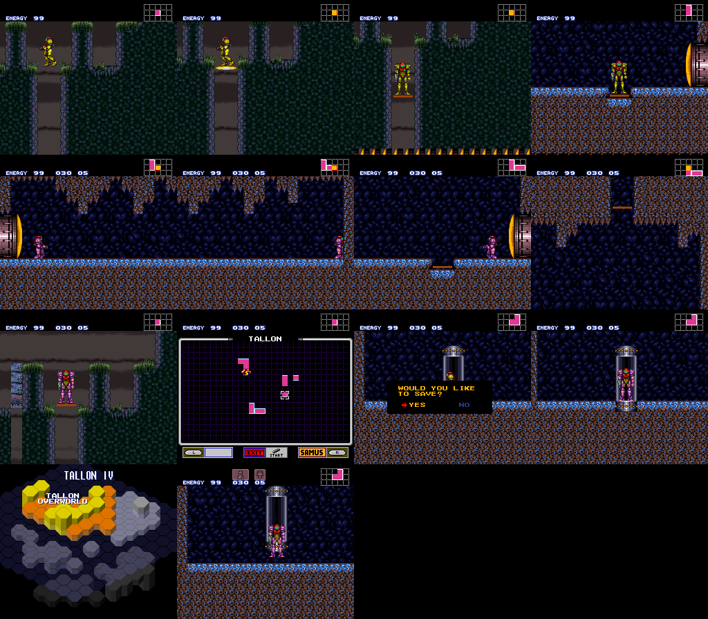

# 20e — A entrada da Impact Crater (Crater Entry Point, Save Station, Crater Tunnel A e o teleporte do Artifact Temple)

Estado: verificada (10/11/2026: validate "265 salas, 548 portas, 0 problemas" com a linha nova "impact crater (specs/20e) …", as linhas
do Tallon e das rodadas iguais às de antes; `.ips` sha1 `fe45064cfaf723164e0e7fc423e2aa4b87d5e221` igual em dois builds (antes `f5b0f58b…dac`: a ROM muda, a
primeira sala da cratera); grupos A 34/34 (3 min 9 s), B 64/64 (3 min 17 s), C 22/22 (4 min 12 s), D 20/20 (3 min 15 s))
Esforço estimado: 1,5–2 dias (gasto: 1 sessão)
Épico: [20 — Impact Crater](20-impact-crater.md) (decisões 2 e 7; linha 20e da tabela de filhas); modelos: [19f](19f-regiao-a-mines.md)
(região construída com portas, save e mapa), [19e](19e-elevadores-da-mines.md) e [12e](12e-elevadores-de-verdade.md) (elevadores de
verdade), [19k](19k-omega-pirate.md) (o chefe que abre a cratera), [20c](20c-grafo-e-mapa-impact.md) (grafo e mapa),
[20d](20d-estilo-impact.md) (a cara).

## Contexto

Até a 20d a cratera era só dados (grafo, mapa, travas, estilo) e a ROM do jogo não tinha sala nenhuma dela. Esta filha constrói a
**região A** (a entrada): a **Crater Entry Point** (com a Save Station do Prime) e a **Crater Tunnel A**, e liga o teleporte do
**Artifact Temple** do Tallon, que pela decisão 7 do épico (aceita pelo usuário) funciona **depois do Omega Pirate (19k), sem
artefatos**. É a primeira filha que muda a ROM no épico.

## Estado atual verificado (antes)

- validate "263 salas, 546 portas, 0 problemas"; `.ips` sha1 `f5b0f58b3cd6ef58d573403852b091a7446b0dac`
  (`scratchpad/s20e/v_before.txt`, `build_before.txt`); linha "impact crater (specs/20c) … 0 construídas" e "impact crater (specs/20b)
  … 12 de 12 salas por construir".
- `tools/impact/rooms.py` (20c): região A = P0 Crater Entry Point (2×2, mapa 26,14, porta R1) e P1 Crater Tunnel A (2×1, mapa 28,15,
  portas L0 e R0); as duas docas da ligação Entry Point ↔ Tunnel A são **portas de plasma** (`DOCK_LOCKS` key, `KEY_BEAM` plasma);
  nenhuma feature na região A (o trilho de Spider é da Tunnel B).
- O Artifact Temple (`tallon/layouts.py`) era só casca: "sem teleporte". O Prime entra na cratera por um `WorldTeleporter` (20a).
- O Omega Pirate (19k): a arena `mines_elite_quarters` liga o **bit `$10` dos bits de chefe da área 5** (`$7E:D82D`) quando a luta é
  vencida (a rotina das arenas); o `mines_omega_pirate` vence a luta de verdade e lê o bit; os testes de rota usam o atalho
  `MINES_OMEGA_WON_BY_RAM` (`poke 7ED82D 10`). **É esse o evento que o jogo já tem** e que esta filha usa.
- A condição de estado de sala do SM `$E629` lê só os bits de chefe da **área atual**; o templo é da área 0 e o bit é da área 5:
  nenhuma condição vanilla serve (lido em `$8F:E5D2–E640` da ROM base).
- O único elevador vanilla dentro de uma área (Norfair ↔ Lower Norfair, `$8F:AF3F ↔ $B236`) usa as flags `$A0/$B0` (elevador sem
  troca de área); os nossos usam `$C0` (com troca).

## Premissas (declaradas antes de agir)

1. A cratera fica **na área 0 com o Tallon** (decisão 2): as salas construídas entram no mesmo `AreaDef` do Tallon (uma área do SM =
   um mapa de pausa, uma lista de estações, um mapa salvo), depois das salas do Tallon.
2. O teleporte do Prime vira um **elevador de verdade** (o mecanismo dos `WorldTeleporter` desde a 12e), descendo do templo para a
   Entry Point, os dois na área 0.
3. "Liga depois do Omega" = o bit `$10` da área 5 (a vitória da arena dele). Sem artefatos.
4. A música da cratera fica a da área 0 (a do Tallon): a 20d deixou a música fora do escopo.

## Mudança feita

1. **Salas** (`tools/impact/layouts.py`, novo; as regras de sempre: porta lateral nas linhas 6–9 da tela, chão na 10):
   - **Crater Entry Point** (2×2): uma caverna na sala inteira, chão na linha 26 (a da porta R1) de parede a parede; a **plataforma do
     elevador** na tela leste (x 128 dela, poço de 2 blocos do topo da sala até a plataforma); o **pedestal da Save Station** a oeste,
     no mesmo chão, **fora do caminho** da plataforma à porta (a estação prende a Samus quando ela para em cima); teto em estalactites.
   - **Crater Tunnel A** (2×1): o túnel na linha 10, o teto em estalactites (sempre 4 linhas livres ou mais). A porta R0 (para a Phazon
     Core) fica parede até a 20f.
   - As duas na **cara da cratera** (20d: tileset `$03`, as peças da rocha da Mines, o fundo dela). Agora a entrada `$03` é escrita
     na ROM do jogo (a 20d já fazia isso quando existisse sala `impact_*`).
2. **Grafo** (`tools/impact/rooms.py`): `ACTIVE_REGIONS = {"A"}`; `build_rooms` usa os desenhos e a cara; `GATES`: a ligação
   Entry Point ↔ Tunnel A com a **tampa de plasma dos dois lados** (a cor do Prime). `TELEPORTER = ("tallon_artifact_temple",
   "impact_entry_point")`, `OPENS_AFTER = "mines_elite_quarters"`.
3. **Área 0** (`tools/areas.py`): `TALLON.rooms` = as 44 do Tallon + as da cratera; a Save Station da Entry Point = **estação 2 da área
   0** (`gunship_stations`); o mapa salvo guarda as duas tabelas inteiras (**70 de 80 bytes**, a conta da 20c: não muda mais quando as
   outras regiões vierem); `ELEVATORS` ganha o par do teleporte.
4. **O teleporte** (`tools/tallon/layouts.py` `artifact_temple`): a plataforma no chão do templo entre o 3º e o 4º totem
   (`TEMPLE_PAD` = 18; poço até o fundo da sala), descendo; a Entry Point sobe. No `build.py`:
   - saída do elevador com as flags **`$80`** (elevador sem troca de área, `ELEVATOR_SAME_AREA_FLAGS`), só para esse par;
   - **dois estados** no templo: o padrão (Omega vivo) **sem a plataforma** na população e com um código de sala de 4 bytes
     (`STZ $0E16 / RTS`, `room_reader.ELEVATOR_FLAGS_OFF`) que mantém `elevator_flags` desligado; o outro **com a plataforma**,
     escolhido por uma **condição de estado nossa** (`room_reader.other_area_boss_condition(5, $10)`: `LDA $7ED82D / AND #$10 / BEQ /
     LDA $0000,X / TAX / JMP $E5E6 / INX / INX / RTS`, 19 bytes no `$8F`, no molde da `$E5FF` vanilla). Os dois estados são iguais no
     resto (nível, tileset, música, fundo).
   - `smlib/room_reader.py` reconhece essa condição pelo código (0 bytes de argumento) e `roomgraph.structures` conta a condição e o
     código como bytes nossos (a checagem das faixas recuperadas do `$8F` continua valendo).
5. **Validador** (`tools/validate.py`):
   - **`check_impact_rooms`** (novo, linha "impact crater (specs/20e)"): as salas construídas = as das regiões ativas, todas com
     desenho e na cara da cratera; as travas do Prime das ligações construídas com a tampa da cor dele dos dois lados; `GATES` só onde o
     Prime tem trava; nenhuma trava de evento numa ligação construída; a save station só na Entry Point (a do Prime), com estação de
     carga; **a rodada em que o teleporte abre** = a primeira em que o passeio chega à arena do Omega com o que ela pede (`needs`): 6;
     com o equipamento dela, da plataforma da Entry Point toda sala construída e, de todo lugar, a volta à plataforma;
   - `check_elevators`: o par do teleporte aceito na mesma área (o Artifact Temple P16 do Tallon e a Entry Point da cratera, os dois na
     área 0), fora da tabela `PRIME_ELEVATORS` (que é entre mundos);
   - `check_elevators_in_rom`: a saída do teleporte com `$80` e a mesma área; **`check_teleporter_states`** (novo): 2 estados, o
     padrão sem a plataforma e com o `ELEVATOR_FLAGS_OFF`, o outro com a plataforma, sem código, escolhido pela condição do bit `$10`
     da área 5 (= `build.teleporter_condition`), iguais no resto;
   - o passeio das rodadas (`world_rooms`, `check_tallon_rounds`, a lista de elevadores da linha das rodadas) deixa as salas da cratera
     e o teleporte de fora: a cratera tem a linha dela; `check_impact_style` não conta as salas da cratera como "outra área no `$03`".
6. **Testes** (grupo D: `TEST_GROUP_D` ganha o prefixo `impact_`): `impact_entrada_rota` e `impact_save_station` (abaixo).

### Linhas do validador (o que mudou)

- **Iguais** (diff contra `scratchpad/s20e/v_before.txt`): "tallon (tabela inteira, regiões ativas: ABCDE, 44 salas construídas,
  alcançáveis agora: 44, 20 itens em 7 rodadas): …" e "rodadas (specs/12m, 17j, 18n, 19m): … 88 itens em 7 rodadas … 88% …".
- Nova: **"impact crater (specs/20e; regiões ativas: A): 2 salas construídas (impact_entry_point, impact_tunnel_a), ligações entre
  elas: 1; entrada pelo teleporte do tallon_artifact_temple (elevador da área 0, sem troca de área) depois do Omega Pirate (arena
  mines_elite_quarters, bit $10 da área 5): rodada 6; com o equipamento dela, da plataforma toda sala construída e de toda sala a
  volta à plataforma; travas do Prime nas ligações construídas: 2 docas key com a tampa da cor do Prime; save station:
  impact_entry_point (estação 2 da área 0)"**.
- "impact crater (specs/20c) … 0 construídas" → **"… 2 construídas"**; "impact crater (specs/20b): $8F livre 2849 … para ~1050; $A1
  livre 8786 … para ~200; 12 de 12 salas por construir" → **"$8F livre 2676 (principal 1, faixas recuperadas 2675) para ~875; $A1
  livre 8748 (principal 609, faixas recuperadas 8139) para ~167; 10 de 12 salas por construir"**; "impact crater (specs/20d) … ROM do
  jogo: entrada 03 vanilla (sem sala da cratera)" → **"… ROM do jogo: entrada escrita"**.
- "263 salas, 546 portas" → **"265 salas, 548 portas"**; SRAM do mapa livre de cada área 23 bytes a menos (a lista da área 0: 47 → 70);
  `$8F` recuperado: 8960 → 9133 usados; os níveis que cruzam banco mudaram (agora `chozo_gathering_hall` e
  `mines_transport_tallon_south`: os testes `nivel_cruza_banco_*` são gerados do manifest).

Fotos do emulador (`build/tests/20e_*`), da esquerda, de cima. `impact_entrada_rota`: o templo com o Omega vivo (sem plataforma; DOWN não
faz nada); o templo com o Omega morto (a plataforma); descendo; a chegada na Entry Point (a porta de plasma à direita); a Tunnel A; o
fim dela (a parede da R0); de volta na Entry Point; subindo; no templo; o mapa de pausa "TALLON" com as telas da cratera.
`impact_save_station`: a pergunta no pedestal; salvo; a tela de área "TALLON / OVERWORLD"; o continue no pedestal da Entry Point.

## Critérios de aceite

1. validate "0 problemas" com a linha nova da 20e e as linhas do Tallon e das rodadas iguais. **Passa.** (protege = salas, travas,
   save, a rodada do teleporte, o caminho de ida e volta, os dois estados do templo e a condição na ROM; falha_quando = as mutações;
   não_prova = que a forma agrada)
2. `impact_entrada_rota` (protege = o teleporte desligado com o Omega vivo, ligado com o bit `$10`, a ida e a volta pelo elevador sem
   trocar de área, a porta de plasma aberta pelo Plasma dos dois lados, a Tunnel A andada até a parede, os bits explorados e o mapa de
   pausa da área 0; falha_quando = sem o `ELEVATOR_FLAGS_OFF` a Samus ficou congelada na sala seguinte (achado real, antes da
   correção); as mutações de ROM não foram rodadas no emulador, só no validador) e `impact_save_station` (protege = save andando até o pedestal na estação 2 da área 0, bit de
   estação usada, game over, tela de área "TALLON / OVERWORLD", continue no pedestal com o marcador, o bit do Omega salvo).
   **Passam.**
3. Dois builds com o mesmo sha1. **Passa** (`fe45064cfaf723164e0e7fc423e2aa4b87d5e221`).
4. Todos os grupos (a ROM mudou). **Passa:** A 34/34, B 64/64, C 22/22, D 20/20 (na ordem A → B → C → D).
5. Mutações pegas (abaixo). **Passa.**

## Mutações (`scratchpad/s20e/mutate.py` → `mutate.out`, em memória: os módulos carregados e uma cópia da ROM; nada no código real)

| Mutação | Resultado |
|---|---|
| M0 controle (lógica e ROM) | limpa |
| M1 porta Entry Point → Tunnel A sem a trava de plasma | pega ("é de plasma no Prime, a sala tem a tampa None") |
| M2 a mesma porta de gelo | pega |
| M3 **save fora do chão** (linha 20, no ar) | pega ("save station em (8,20) sem pedestal sólido") |
| M4 save na Tunnel A em vez da Entry Point | pega ("o Prime tem a da impact_entry_point") |
| M5 Tunnel A no tileset do Tallon | pega ("fora da cara da cratera") |
| M6 teleporte esperando uma sala sem arena | pega |
| M7 teleporte aberto pelo Phazon Elite (rodada 5, sem o Plasma) | pega ("['impact_tunnel_a'] inalcançáveis … na rodada 5") |
| M8 ROM: estado padrão (Omega vivo) com a plataforma | pega ("o teleporte funcionaria antes do chefe") |
| M9 ROM: condição no bit `$08` (Phazon Elite) | pega |
| M10 ROM: condição nos bits da área 4 | pega |
| M11 ROM: estado sem plataforma sem o `STZ $0E16` | pega |
| M12 ROM: saída do teleporte com troca de área (`$C0`) | pega |
| M13 controle depois | limpa |

## Riscos e reversão

- **O pedestal pede parar em cima**: andando a Samus passa por cima sem salvar; parando nele (o teste anda 96 quadros da plataforma,
  medido: 92–100 param em cima) a estação a prende. Igual às outras save stations; por isso o pedestal fica fora do caminho.
- **Buraco no chão do templo com o Omega vivo**: os blocos de porta da plataforma são desenhados como ar (como os vanilla: a plataforma
  é um sprite), então antes do chefe se vê um vão de 2 blocos no chão (a Samus fica de pé em cima). Visual apenas.
- **Um elevador dentro da área**: flags `$80`, como o vanilla de Norfair; medido no emulador (ida e volta, área 0, mapa e explorados).
- **A tela (30, 20)** que os testes de mapa do Tallon usam como "vazia" é da Subchamber Three: vale enquanto a região C (20g) não for
  construída; a 20g terá de trocar o ponto vazio do teste.
- **Níveis que cruzam banco** mudaram de sala (o alocador de nível andou): os testes gerados acompanham.
- Reversão: `ACTIVE_REGIONS` vazio, `TELEPORTER` fora de `ELEVATORS`, o templo sem `TEMPLE_PAD` (casca de novo), `TALLON` com as salas
  e o mapa salvo de antes; `build.py` (o ramo do templo, `teleporter_*`, `ELEVATOR_SAME_AREA_FLAGS`), `room_reader`/`roomgraph` (a
  condição e o código), `check_impact_rooms`, `check_teleporter_states` e os 2 testes. A ROM volta à da 20d.

## Fora de escopo

- Phazon Core, Missile Station, Tunnel B e inimigos (20f); a descida (20g); o Metroid Prime (20h); o fim (20i).
- Música própria da cratera (premissa 4); um desenho do teleporte no templo (o vão do chão), o ícone de elevador no mapa.

## Decisões para o usuário (escolhidas as recomendadas; confirmar)

1. **O teleporte é um elevador** que desce do Artifact Temple para a Entry Point (a plataforma entre os totens a oeste da pirâmide).
2. **O que abre**: o bit `$10` da área 5 (o Omega Pirate vencido), lido por uma condição de sala nossa. Sem artefatos.
3. **A música** da cratera fica a do Tallon por enquanto.

## Desvios (preenchido na implementação)

- **Código novo no `$8F`** (23 bytes: a condição e o `STZ $0E16`): a decisão 7 precisava de uma condição que o SM não tem (o bit é de
  outra área). O `room_reader` e o `roomgraph` passaram a reconhecê-los.
- **Achado no emulador, corrigido**: com o templo sem plataforma, ficar na plataforma liga `elevator_flags` e nada o desliga (no vanilla
  quem desliga é a IA da plataforma); a porta seguinte trouxe a Samus como se viesse de elevador, congelada numa queda (medido:
  `$0A42 = $E713`, pose `$2A`). Por isso o estado padrão do templo tem o `ELEVATOR_FLAGS_OFF`.
- **As salas da cratera ficam fora do passeio das rodadas** (o teleporte só abre depois do Omega): a cratera é andada por
  `check_impact_rooms` com o equipamento da rodada em que ele abre (6). A linha das rodadas e a do Tallon ficaram iguais.
- **A imagem** `specs/img/20e-entrada.png` é das fotos do emulador (o `preview_rooms.py` não desenha o tileset `$03` da cratera: as salas
  saem em xadrez nos `research/render/tallon_impact_*.png`).
- Verificação (10/11/2026, pasta real): `python3 -I tools/build.py` duas vezes → sha1 `fe45064cfaf723164e0e7fc423e2aa4b87d5e221` nas
  duas; `python3 -I tools/validate.py` → "265 salas, 548 portas, 0 problemas" (diff: as linhas do Tallon e das rodadas idênticas);
  `--grupo A` 34/34, `--grupo B` 64/64, `--grupo C` 22/22, `--grupo D` 20/20 (com `impact_entrada_rota` e `impact_save_station`).
