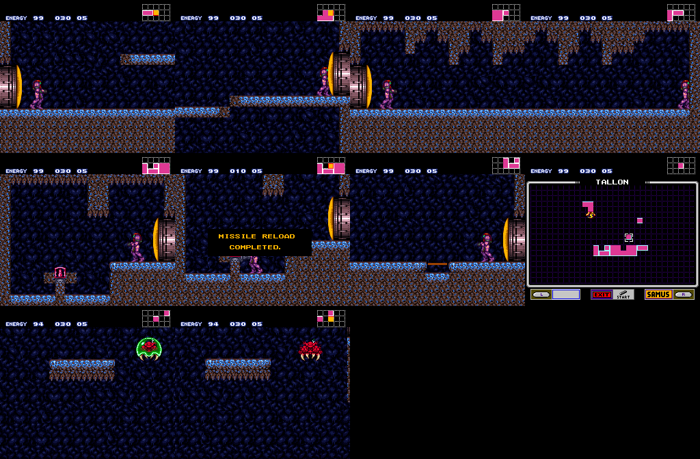

# 20f — Phazon Core, Crater Missile Station e Crater Tunnel B (a cratera de cima)

Estado: verificada (11/11/2026: validate "268 salas, 554 portas, 0 problemas" com a linha nova "impact crater (specs/20f) …" e a da
20e com "regiões ativas: AB"; as linhas do Tallon e das rodadas iguais às da 20e; `.ips` sha1 `5052bbe770007aac2889fba0bc2c9768308abf5f`
igual em dois builds (antes `fe45064c…221`: a ROM muda, três salas novas); grupos A 34/34 (3 min 18 s), B 64/64 (3 min 48 s), C 22/22 (4 min 27 s), D 22/22 (3 min 35 s))
Esforço estimado: 2–2,5 dias (gasto: 1 sessão)
Épico: [20 — Impact Crater](20-impact-crater.md) (linha 20f da tabela de filhas); modelos: [20e](20e-entrada-impact.md) (salas da
cratera na área 0, rota no emulador), [19g](19g-inimigos-mines.md) (inimigos da camada 0, justos, a regra da câmera), [19l](19l-regiao-d-mines.md)
(a recarga de mísseis), [20c](20c-grafo-e-mapa-impact.md) (grafo e travas), [20d](20d-estilo-impact.md) (a cara).

## Contexto

A 20e pôs na ROM a região A da cratera (a Crater Entry Point com a Save Station e a Crater Tunnel A, com a porta R0 da Tunnel A ainda
parede). Esta filha constrói a **região B** (`tools/impact/rooms.py` `REGIONS["B"]`): a **Phazon Core** (o salão do meio, 5×3), a
**Crater Missile Station** (beco com a recarga de mísseis do Prime, 1×1) e a **Crater Tunnel B** (2×1, a porta para a Infusion Chamber
fica parede até a 20g), com as portas de plasma do Prime e os inimigos comuns da camada 0.

## Estado atual verificado (antes)

- validate "265 salas, 548 portas, 0 problemas"; `.ips` sha1 `fe45064cfaf723164e0e7fc423e2aa4b87d5e221`; grupos A 34/34, B 64/64,
  C 22/22, D 20/20 (20e).
- `tools/impact/rooms.py`: `ACTIVE_REGIONS = {"A"}`; região B = P2 Phazon Core (5×3, mapa 30,13; portas L2 → Tunnel A, L1 → Missile
  Station, R1 → Tunnel B), P3 Missile Station (1×1, mapa 29,14; R0), P4 Tunnel B (2×1, mapa 35,14; L0, R0 → Infusion Chamber); as 6 docas
  dessas ligações são `key` de **plasma** dos dois lados (`DOCK_LOCKS`, `KEY_BEAM`); `FEATURES` da Tunnel B = `spider` (trilho).
- O Prime, camadas de script (lidas agora de `research/prime_fs`, `scratchpad/s20f/impact_layers.py` → `impact_layers.out`):

| Sala | Camada 0 "Default" (ativa) | Outras camadas |
|---|---|---|
| Crater Entry Point | nenhum inimigo | — |
| Crater Tunnel A | WallCrawlerSwarm 1 (e VisorGoo, efeito de visor) | — |
| Phazon Core | **MetroidAlpha 4**, FishCloud 3 (e TeamAIMgr, gerente de IA) | 1 "Don't Load", inativa, vazia |
| Crater Missile Station | FishCloud 4; `SpecialFunction` ×2 (a "Missile Station", 20a) | — |
| Crater Tunnel B | nenhum inimigo; 31 `SpiderBallWaypoint` | **1 "Don't load", inativa**: Burrower 1, WallCrawlerSwarm 1, VisorGoo 1 |

- **Achado:** o Burrower que a 20a propôs para a Tunnel B fica numa camada **inativa** ("Don't load") no Prime: pela regra da camada 0
  (a de todas as áreas) a Tunnel B fica sem inimigo. Se algum script liga essa camada: **não lido** *(incerto)*.

## Premissas (declaradas antes de agir)

1. As salas da região B entram na área 0 com o Tallon, depois das da região A (o molde da 20e); a cara da cratera (tileset `$03`).
2. As travas = as do Prime: as três ligações de B (Tunnel A ↔ Phazon Core, Missile Station ↔ Phazon Core, Phazon Core ↔ Tunnel B) com a
   tampa de plasma dos dois lados. A Tunnel B → Infusion Chamber (região C) fica parede até a 20g.
3. A recarga de mísseis do Prime = a missile station do SM (PLM `$B6EB`, a da Mines na 19l). Não é item: a conta continua 88.
4. Inimigos = a camada 0 do Prime, as espécies que já existem (nenhuma cópia nova), no máximo 1 por tela, justos em toda sala (a cratera
   só abre na rodada 6, como a regra da Mines). O Fission Metroid (`MetroidAlpha`) = o Metroid justo de Phendrana (18l), o mesmo que a
   Mines usa para o mesmo tipo (19i).
5. O trilho de Spider Ball da Tunnel B fica de fora (o jogo não tem Spider Ball, épico 18): um túnel simples.

## Mudança feita

1. **Salas** (`tools/impact/layouts.py`):
   - **Phazon Core** (5×3): o salão com chão na linha 42 (a da porta L2); na parede oeste a prateleira da L1 (linha 26, colunas 1–10)
     com o zigue-zague da Omega Research da Mines (37, 32, 27); na parede leste o espelho para a prateleira da R1; uma coluna de phazon
     pendurada do teto no meio; dois poleiros de rocha no alto (linha 12), um para cada Metroid.
   - **Crater Missile Station** (1×1): a estação de recarga (`Canvas.refill_station` em (5, 13)) no chão da linha 13, a Samus chega pelo
     leste; um degrau de 3 linhas debaixo da beirada da R0 (o da Mines espelhado); uma prateleira de mísseis.
   - **Crater Tunnel B** (2×1): o túnel na linha 10, teto em estalactites (sempre 4 linhas livres). Sem trilho de Spider Ball.
2. **Grafo** (`tools/impact/rooms.py`): `ACTIVE_REGIONS = {"A", "B"}`; `GATES` com as três ligações de B, plasma dos dois lados;
   `MISSILE_STATION = "impact_missile_station"`; `build_rooms` passa `missile_station` do desenho.
3. **Inimigos** (`tools/impact/enemies.py`, novo, molde da Mines): `ENEMIES` = **2 Metroids na Phazon Core** (24, 12) e (54, 12), nas
   telas (1, 0) e (3, 0), longe da câmera das três portas; `STAND_IN` (MetroidAlpha → Metroid; FishCloud e WallCrawlerSwarm → fora);
   `PRIME_LAYER0` (Tunnel A, Phazon Core, Missile Station); `PRIME_INACTIVE_LAYERS` (a Tunnel B: Burrower e enxame, nunca postos).
   `tools/areas.py`: `TALLON.enemies` = os do Tallon + os da cratera.
4. **Validador** (`tools/validate.py`):
   - **`check_impact_enemies`** (novo, linha "impact crater (specs/20f)"): `check_layer0_enemies` só nas salas da cratera, justos em
     toda sala (`IMPACT_FAIR_EVERY_ROUND`); `PRIME_LAYER0`/`PRIME_INACTIVE_LAYERS` só com salas das regiões A e B; nada em sala fora do
     build nem em sala onde o Prime só tem inimigo em camada inativa; **no máximo 1 por tela, tela a tela** (a regra antiga só conta o
     total contra o número de telas: a M2 abaixo passava); nenhum chefe; `chaser_problems`/`homing_problems`/`shooter_problems`.
   - `check_tallon_enemies` passa a olhar só as salas do Tallon (`tallon_only()`): a cratera tem a tabela dela.
   - `check_impact_rooms`: a **recarga de mísseis só na Missile Station** (a do Prime) e a linha da 20e diz onde ela está. As travas, a
     rodada do teleporte e o caminho de ida e volta já valiam para as salas novas (o laço da 20e é genérico).
   - `check_missile_station` (19l: um lado de pé alcançável) e o PLM `$B6EB` na ROM (`check_arrival`) já percorriam toda área.
   - `check_impact_space` conta sozinho pelas chaves `impact_*` do manifest: **7 de 12 salas por construir**.
5. **Testes** (grupo D, prefixo `impact_`):
   - novo **`impact_regiao_b_rota`**: desce à cratera (`crater_down`: o Omega morto por RAM, o equipamento da rodada 6) e **anda**:
     Entry Point → Tunnel A → R0 (plasma) → Phazon Core na L2 (os 2 Metroids vivos, fora da câmera) → chão até a parede leste → sobe o
     zigue-zague leste → R1 → Tunnel B até a parede leste (a R0, parede) → volta pela L0 → desce → parede oeste → sobe o zigue-zague
     oeste (os passos da Omega Research, `M19I_OR_UP`) → L1 → Missile Station: com 10 mísseis, anda até a estação, **"MISSILE RELOAD
     COMPLETED", mísseis 30 de 30** → sai → desce → L2 → Tunnel A → Entry Point → plataforma → sobe ao templo; energia 99 o caminho
     todo; os bits explorados e o mapa de pausa.
   - novo **`impact_inimigos_vivos`**: entra na Phazon Core pelas três portas (atalho), os 2 Metroids nos slots com a vida cheia, parada na
     porta sem perder energia; foto de cada Metroid (ele vem até a Samus).
   - `entradas_de_porta_tallon` (spec 15) agora inclui as 3 portas da Phazon Core (gerado de `TALLON.enemies`): entrada de verdade,
     nenhum dano nos primeiros 120 quadros.
   - `impact_entrada_rota` (20e): o fim da Tunnel A agora é a tampa de plasma da R0 (coluna 30), não a parede (coluna 31): a
     expectativa de x passou de `$01EB` para `$01DB` (achado na primeira rodada do grupo D: "FAIL 7E0AF6 = 01DB, esperado 01EB").
   - `level_crossing_test` ganhou o ramo de **Phendrana**: o alocador de nível andou e agora `phendrana_gravity_chamber` cruza banco
     (antes `mines_transport_tallon_south`); o gerador não sabia chegar numa sala de Phendrana.

### Linhas do validador (o que mudou)

- **Iguais** às da 20e: "tallon (tabela inteira, regiões ativas: ABCDE, 44 salas construídas, alcançáveis agora: 44, 20 itens em 7
  rodadas): …" e "rodadas (specs/12m, 17j, 18n, 19m): … 88 itens em 7 rodadas …".
- Nova: **"impact crater (specs/20f): 2 inimigos em 1 salas (metroid 2); camada 0 do Prime, no máximo 1 por tela (tela a tela); justos
  em toda sala (até 5 tiros do Power Beam, até 20 por toque); os que voam até a Samus fora da câmera de toda porta; fora (camada que não
  carrega no Prime): tunnel_b (Burrower 1, WallCrawlerSwarm 1)"**.
- 20e: "regiões ativas: A … 2 salas construídas … ligações entre elas: 1 … 2 docas key" → **"regiões ativas: AB): 5 salas construídas
  (…, impact_phazon_core, impact_missile_station, impact_tunnel_b), ligações entre elas: 4 … 8 docas key com a tampa da cor do Prime;
  save station: impact_entry_point (estação 2 da área 0); recarga de mísseis: impact_missile_station"**.
- 20c: "… 2 construídas" → **"… 5 construídas"**. 20b: "$8F livre 2676 … para ~875; $A1 livre 8748 … para ~167; 10 de 12" →
  **"$8F livre 2499 (principal 1, faixas recuperadas 2498) para ~613; $A1 livre 8713 (principal 574, faixas recuperadas 8139) para
  ~117; 7 de 12 salas por construir"**.
- "265 salas, 548 portas" → **"268 salas, 554 portas"**; `$8F` recuperado: 9133 → 9310 usados; níveis que cruzam banco: agora
  `chozo_gathering_hall_access` e `phendrana_gravity_chamber`.

Fotos do emulador (`build/tests/20f_*`), da esquerda, de cima: a chegada na Phazon Core pela L2; na prateleira da R1 depois do
zigue-zague leste; a Tunnel B; o fim dela (a parede da R0); a Missile Station; "MISSILE RELOAD COMPLETED"; de volta na Entry Point; o mapa
de pausa com as telas da região B; os dois Metroids (`impact_inimigos_vivos`).

## Critérios de aceite

1. validate "0 problemas" com a linha nova da 20f e as linhas do Tallon e das rodadas iguais. **Passa.** (protege = salas, travas de
   plasma, recarga só na Missile Station e com lado de pé, a ida e a volta, inimigos da camada 0, tela a tela, justos, fora da câmera das
   portas, ROM = tabela; falha_quando = as mutações; não_prova = que a forma agrada)
2. `impact_regiao_b_rota` (protege = a rota da entrada à Tunnel B e a volta ao templo andando, as portas de plasma, os zigue-zagues, a
   recarga de verdade (10 → 30 mísseis), energia 99, os bits explorados e o mapa) e `impact_inimigos_vivos` (protege = os 2 Metroids nos
   slots com a vida cheia, nenhum dano na chegada pelas três portas). **Passam.**
3. Dois builds com o mesmo sha1. **Passa** (`5052bbe770007aac2889fba0bc2c9768308abf5f`).
4. Todos os grupos (a ROM mudou), na ordem A → B → C → D. **Passa:** A 34/34 (3 min 18 s), B 64/64 (3 min 48 s), C 22/22 (4 min 27 s), D 22/22 (3 min 35 s). A primeira rodada do D deu 21/22
   (`impact_entrada_rota`, a expectativa da 20e no fim da Tunnel A, ajustada acima); o D rodado de novo inteiro: 22/22.
5. Mutações pegas (abaixo). **Passa.**

## Mutações (`scratchpad/s20f/mutate.py` → `mutate.out`, em memória: os módulos carregados e uma cópia da ROM; nada no código real)

| Mutação | Resultado |
|---|---|
| M0 controle (lógica) | limpa |
| M1 5 Metroids na Phazon Core (o Prime tem 4) | pega ("5 MetroidAlpha, o Prime tem 4 na camada 0") |
| M2 os dois Metroids na mesma tela (1, 0) | pega ("mais de um inimigo nas telas [(1, 0)]"); **antes da regra tela a tela, passava** |
| M3 Metroid na prateleira da L1 | pega ("na câmera da porta 1 (L1) … em 0 quadros", "colado na porta") |
| M4 Sova (Burrower) na Tunnel B | pega ("não substitui nenhum inimigo do Prime", "camada que não carrega") |
| M5 Phazon Core sem Metroid | pega |
| M6 porta Phazon Core → Tunnel B sem a trava de plasma | pega ("é de plasma no Prime, a sala tem a tampa None") |
| M7 recarga na Tunnel B em vez da Missile Station | pega ("o Prime tem a da impact_missile_station", "sem lado … de pé") |
| M8 recarga também na Phazon Core | pega |
| M9 recarga fora do chão (linha 9) | pega ("sem lado onde a Samus alcance o terminal de pé") |
| M10 controle depois | limpa |
| R0 controle (ROM) | limpa |
| R1 ROM: a Missile Station sem o PLM `$B6EB` | pega ("sem o PLM de missile station $B6EB em (5,11)") |
| R2 ROM: um Metroid 1 bloco a leste na população | pega ("sem a população/enemy set da tabela") |
| R3 controle depois (ROM) | limpa |

As mutações de ROM não foram rodadas no emulador, só no validador.

## Riscos e reversão

- **Os Metroids ficam no alto, fora do caminho**: a rota não passa por eles (a câmera nunca os mostra no chão nem nas prateleiras da
  linha 26). Quem sobe até os poleiros os acorda (foto). Se a 20g ou a 20j mudar o caminho, conferir a regra da câmera.
- **A tela (30, 20)** dos testes de mapa (o "vazio" do Tallon) continua fora de toda sala construída: a Phazon Core ocupa x 30–34, y
  13–15; a 20f não a usa. A pendência é da 20g (Subchamber Three).
- **Níveis que cruzam banco** mudaram de novo (o alocador andou): o gerador `level_crossing_test` precisou do ramo de Phendrana. Uma
  sala nova de outra área pode pedir outro ramo (Magmoor, por exemplo, ainda não tem).
- **Zigue-zague leste espelhado**: medido no emulador (os passos da Omega Research espelhados passaram de primeira).
- Reversão: `ACTIVE_REGIONS = {"A"}`, `GATES` só com a ligação da região A, `impact/enemies.py` e o `IMPACT_ENEMIES` em `areas.py` fora,
  as três funções novas de `layouts.py`, `check_impact_enemies`/`tallon_only`/`crater_only` e a checagem de recarga em
  `check_impact_rooms`, os 2 testes e o ramo de Phendrana. A ROM volta à da 20e.

## Fora de escopo

- A Infusion Chamber e as Subchambers (20g), a Lair e o Metroid Prime (20h), o fim (20i).
- O trilho de Spider Ball da Tunnel B; os peixes (FishCloud) e os enxames de parede (WallCrawlerSwarm): sem par no SM.
- Música própria da cratera; ícone de recarga no mapa (a 19l também não pôs).

## Desvios (preenchido na implementação)

- **2 inimigos, não 3**: a 20a propôs 2 Metroids e 1 Burrower, mas o Burrower da Tunnel B está numa camada inativa do Prime ("Don't
  load"); pela regra da camada 0 (a de todas as áreas) a Tunnel B fica vazia. Gravado em `PRIME_INACTIVE_LAYERS` e checado (M4).
  **Pergunta ao usuário:** quer a Sova na Tunnel B mesmo assim (como enfeite do épico)?
- **Regra nova no validador**: "no máximo 1 por tela" agora é conferido tela a tela na cratera (a regra antiga, das outras áreas, só
  compara o total com o número de telas). As outras áreas não mudaram.
- **`level_crossing_test` com Phendrana** (fora da cratera, mas exigido para os testes rodarem: o gerador quebrava com a sala nova que
  cruza banco).
- **Foto dos Metroids** com 120 quadros depois de despausar (a 19g usava 30: aqui a tela ainda estava preta) e a sala recarregada entre
  as duas fotos (o Metroid da primeira prendia a Samus e a pausa seguinte não pegava). Medido.
- Verificação (11/11/2026, pasta real): `python3 -I tools/build.py` duas vezes → sha1 `5052bbe770007aac2889fba0bc2c9768308abf5f` nas
  duas; `python3 -I tools/validate.py` → "268 salas, 554 portas, 0 problemas"; `--grupo A` 34/34, `--grupo B` 64/64 (com `entradas_de_porta_tallon` e os
  `nivel_cruza_banco_*`), `--grupo C` 22/22, `--grupo D` 22/22 (com `impact_regiao_b_rota`, `impact_inimigos_vivos` e os da 20e).
