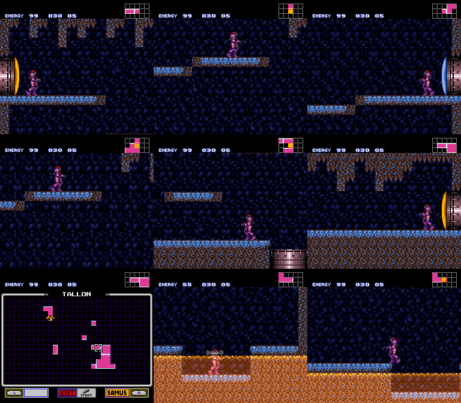

# 20g — Phazon Infusion Chamber e Subchambers 1 a 5 (a descida e o phazon que machuca)

Estado: verificada (11/11/2026: validate "274 salas, 566 portas, 0 problemas" com as linhas da cratera novas e as do Tallon e das
rodadas iguais às da 20f; `.ips` sha1 `e1a2125c8aa995a91f227f42e14e9dae15bc6707` igual em dois builds (antes `5052bbe7…5bf`: a ROM
muda, seis salas novas); grupos A 34/34, B 64/64, C 22/22, D 24/24)
Esforço estimado: 1,5–2 dias (gasto: 1 sessão)
Épico: [20 — Impact Crater](20-impact-crater.md) (linha 20g da tabela de filhas; decisões 3 e 4); modelos: [20f](20f-phazon-core-impact.md)
(salas da cratera na área 0, rota no emulador, mutações), [17d](17d-estilo-das-cavernas-de-lava.md) (a regra da lava: nunca no caminho,
saída em até 5 movimentos, no máximo 3 linhas de fundo), [19](19-phazon-mines.md) decisão 6, opção (b) (o phazon que machuca = o ácido
do SM, só fora do caminho obrigatório).

## Contexto

A 20f pôs na ROM a cratera de cima (regiões A e B), com a porta R0 da Crater Tunnel B ainda parede. Esta filha constrói a **região C**
(`tools/impact/rooms.py` `REGIONS["C"]`): a **Phazon Infusion Chamber** (3×2) e as **Subchambers One a Five** (4×3, 4×2, 4×2, 4×2,
2×4), a descida do Prime até a Metroid Prime Lair (região D, 20h), e o **phazon que machuca** pela decisão 4 do épico: só nessas salas,
nunca no caminho obrigatório sem saída.

## Estado atual verificado (antes)

- validate "268 salas, 554 portas, 0 problemas"; `.ips` sha1 `5052bbe770007aac2889fba0bc2c9768308abf5f`; grupos A 34/34, B 64/64,
  C 22/22, D 22/22 (20f).
- `tools/impact/rooms.py`: `ACTIVE_REGIONS = {"A", "B"}`; as ligações da região C: Tunnel B R0 ↔ Infusion L0 (plasma dos dois lados no
  Prime, e do lado da Infusion também uma trava de evento, "Actor Door Lock"), Infusion B1 ↔ Subchamber One T2, Subchamber One L2 ↔ Two
  R0, Two L1 ↔ Three R0, Three B1 ↔ Four T0, Four R1 ↔ Five L0, Five B0 ↔ Lair T1; da Infusion para baixo **nenhuma porta** (a queda do
  Prime).
- O Prime, camada 0 das 6 salas (lida agora de `research/prime_fs`, `scratchpad/s20g/impact_layers.py` → `layers.txt`): **nenhum
  inimigo comum**. Só a luta do Metroid Prime: `MetroidPrimeStage1` (1 em cada Subchamber de One a Four) e `EnergyBall` (4 em Two,
  Three e Four). A Infusion e a Five não têm nenhum. Outras camadas (Subchamber Two: "Provoke Metroid Prime", "Not Loaded") só com
  gatilhos e câmeras.
- **Dano de área no Prime: nenhum** (nenhum `Area Damage`, 20a). O dano é regra nossa (decisão 4).
- **O mecanismo das outras áreas:** a lava da Magmoor (17d: `RoomDef.lava`, FX tipo 2, `build.room_fx`, `check_lava`) **não machuca
  com a Gravity Suit** (`Samus_Animate_LavaFx`, `sm_90.c:136`: com o bit `$20` equipado, nenhum dano), e a cratera só abre na rodada
  6, com a Gravity. O "padrão b" do épico 19 (decisão 6, nunca usado: a Mines escolheu "só cor") é o **ácido do SM** (FX tipo 4,
  `Samus_Animate_AcidFx`, `sm_90.c:161`): 1,5 por quadro, ¼ com a Gravity, ½ só com a Varia; mesma física da lava
  (`Samus_Animate_SubmergedLavaAcid`). A ROM vanilla tem ácido na própria área 0 (Crateria, sala `$92B3`, FX `$83:80E0`).

## Premissas (declaradas antes de agir)

1. As salas da região C entram na área 0 depois das das regiões A e B (molde da 20e/20f), na cara da cratera (tileset `$03`).
2. Travas = as do Prime: Tunnel B ↔ Infusion de plasma dos dois lados; da Infusion para baixo nenhuma tampa. A trava de evento da
   Infusion (a porta que tranca atrás na descida final do Prime) fica **fora**: a luta é só na Lair (decisão 3) e a volta ao templo
   continua aberta (o validador anda a volta).
3. O phazon que machuca = o ácido do SM pelo mesmo caminho da lava (a linha da superfície na `RoomDef`, o FX escrito pelo build, a
   regra da `check_lava`), não um mecanismo novo.
4. O FX cobre a sala inteira da superfície para baixo (BG3; o desvio já anotado na 17d). Uma sala com porta de chão (a Infusion, as
   Subchambers Three e Five) não pode ter ácido: a queda passaria por ele. O ácido vai nas outras três, em poças fora do caminho.
5. Inimigos: a camada 0 do Prime nessas salas é só a luta do Metroid Prime, que pela decisão 3 fica na Lair: as 6 salas ficam vazias
   (como a 20f fez com o Burrower).

## Mudança feita

1. **Salas** (`tools/impact/layouts.py`, as regras de sempre: porta lateral nas linhas 6–9 sobre a beirada; sala com porta de chão
   com o chão na linha h−3; plataforma da porta do teto na linha 6; subidas de 5 linhas em zigue-zague, toda porta a pé sem o Space
   Jump, a volta também):
   - **Phazon Infusion Chamber** (3×2): a prateleira da L0 (linha 10), o chão na linha 29 com o buraco (B1, sem tampa); de volta, o
     zigue-zague (24, 19, 14) nas mesmas colunas do oeste da Phazon Core; dois tanques pendurados do teto.
   - **Subchamber One** (4×3): chão na linha 42 (L2), a plataforma da porta do teto (T2) e sete degraus em zigue-zague (37 a 7) até ela;
     **poça de phazon** nas colunas 51–57, fora do caminho (a Samus cai da plataforma a oeste dela e anda para oeste).
   - **Subchamber Two** (4×2): prateleira da R0 (linha 10), chão na 26 (L1), zigue-zague (21, 16, 11); **poça** contra a parede leste.
   - **Subchamber Three** (4×2): prateleira da R0, chão na 29 com o buraco (B1), zigue-zague (24, 19, 14). Sem ácido.
   - **Subchamber Four** (4×2): plataforma da porta do teto (T0), chão na 26 (R1), zigue-zague (21, 16, 11) até a plataforma;
     **poça** contra a parede oeste, debaixo da plataforma.
   - **Subchamber Five** (2×4): prateleira da L0, o poço até o chão na linha 61 (a porta de chão B0 para a Lair é parede até a 20h),
     dez degraus em zigue-zague de volta. Sem ácido.
   - Toda poça: 7 colunas, 2 linhas de fundo, a superfície (`ACID`) na linha de baixo do chão (o pé de quem anda nunca chega nela).
2. **O ácido** (`tools/frigate/rooms.py` `RoomDef.acid` e `RoomDef.liquid`; `tools/smlib/lava.py` `ACID_TYPE`, `acid_fx_entry`,
   `ACID_DAMAGE_PER_FRAME`; `tools/build.py` `room_fx`): a entrada de FX = a vanilla da Crateria (`$83:80E0`) com a nossa superfície e as
   opções de líquido **`$02`** em vez de `$42`. Medido no emulador: com `$42` a superfície subia e descia (`$29C`–`$2C8` em volta de
   `$2B0`, a maré grande do bit `$40`, `FxHandleTide $88:B2C9`) e pegava a Samus em pé no chão (99 → 27 andando); com `$02` fica parada.
   O build recusa ácido fora das salas `impact_*` da área 0 ou junto com água/calor/outro FX.
3. **Grafo** (`tools/impact/rooms.py`): `ACTIVE_REGIONS = {"A", "B", "C"}`; `GATES` com Tunnel B ↔ Infusion (plasma); `EVENT_OUT` (a
   trava de evento fora, com o porquê); `build_rooms` passa `acid` de `layouts.ACID`.
4. **Inimigos** (`tools/impact/enemies.py`): `PRIME_FIGHT_LAYER0` (o que o Prime tem na camada 0 da descida: só a luta), nunca posto.
5. **Validador** (`tools/validate.py`):
   - `foot_grid` e as caminhadas usam `r.liquid` (lava ou ácido: lugar onde não se anda).
   - `check_lava` vale para o ácido também (nunca no caminho, toda poça com saída em até 5 movimentos, no máximo 3 linhas de fundo); o
     ácido só nas salas `impact_*` da área 0, nunca com lava.
   - `check_lava_in_rom`: todo estado de sala com ácido aponta para o FX dela; nenhuma outra sala nossa com ácido (FX tipo 4).
   - `check_impact_rooms`: a trava de evento só se estiver em `EVENT_OUT`; `EVENT_OUT` só em doca com trava de evento do Prime; **o
     ácido exatamente nas salas da região C sem porta de chão no grafo do Prime** (decisão 4); a linha da 20e diz onde está.
   - `check_impact_enemies`: nenhum inimigo em sala de `PRIME_FIGHT_LAYER0` (decisão 3); a linha diz que a descida fica vazia.
6. **Testes** (grupo D, prefixo `impact_`; `tests/run_tests.py`):
   - novo **`impact_descida_rota`**: desce à cratera (`crater_down`), entra na Tunnel B (atalho) e **anda**, energia 99 o caminho todo:
     R0 (plasma) → Infusion → desce os degraus e cai no buraco → Subchamber One (na plataforma) → desce o zigue-zague → L2 (tampa azul,
     um tiro) → Subchamber Two → volta → anda até antes da poça → sobe o zigue-zague → plataforma → pulo com giro pela porta do teto →
     Infusion (no buraco; o Space Jump para oeste quando o controle volta) → sobe o zigue-zague → L0 → Tunnel B; bits explorados e o
     mapa de pausa.
   - novo **`impact_phazon_dano`**: na Subchamber One (atalho pelo buraco): o FX de ácido carregado (`$196E` = 4, superfície `$2B0`);
     120 quadros no chão, energia 99; anda até a poça: de 99, **120 quadros depois 54** (−45 = 120 × 0,375, a Gravity); um pulo para
     oeste, fora da poça: **120 quadros depois, a mesma energia**.
   - A tela vazia dos testes de mapa da área 0 passou de **(30, 20)**, que agora cai na Subchamber Three, para **(30, 30)**, fora de
     toda sala do Tallon e da cratera, construída ou não (`TALLON_BLANK`; a asserção olha `impact_rooms.ALL_ROOMS` também). As outras
     áreas continuam com (30, 20) (a Mines com (30, 26)).

Fotos do emulador (`build/tests/20g_*`), da esquerda, de cima: a Infusion na L0; a Subchamber One na plataforma; a Subchamber Two na
R0; de volta na plataforma depois do zigue-zague; a Infusion depois de subir pelo buraco; a Tunnel B; o mapa de pausa; na poça
(energia caindo); fora dela. O ácido aparece **laranja-ferrugem** (a cor do ácido do SM nesta paleta), não azul.

## Critérios de aceite

1. validate "0 problemas" com as linhas da cratera atualizadas e as do Tallon e das rodadas iguais às da 20f. (protege = salas, travas,
   a trava de evento registrada, ácido só nas salas certas, fora do caminho e com saída, FX na ROM, a descida vazia; falha_quando = as
   mutações; não_prova = que a forma agrada)
2. `impact_descida_rota` (protege = a descida e a volta andando, a porta de plasma, o buraco sem porta, a subida pela porta de chão,
   energia 99 no caminho) e `impact_phazon_dano` (protege = o dano dentro da poça com o equipamento da rodada 6 e nenhum dano fora).
3. Dois builds com o mesmo sha1 (a ROM muda).
4. Todos os grupos na ordem A → B → C → D.
5. Mutações pegas.

## Mutações (`scratchpad/s20g/mutate.py` → `mutate.out`, em memória: os módulos carregados e uma cópia da ROM; nada no código real)

| Mutação | Resultado |
|---|---|
| M0 controle (lógica) | limpa |
| M1 ácido no caminho obrigatório (superfície da Subchamber One na linha 41, acima do chão) | pega ("porta 1 (L2) inalcançável", "sem lugar para a Samus ficar de pé") |
| M2 ácido na Infusion Chamber (sala com porta de chão) | pega ("a decisão 4 pede nas salas da descida sem porta de chão", "B1 inalcançável") |
| M3 ácido fora da cratera (Landing Site do Tallon) | pega ("fora da cratera (área 0, salas impact_*)") |
| M4 Subchamber One sem ácido | pega |
| M5 porta Tunnel B → Infusion sem a trava de plasma | pega ("é de plasma no Prime, a sala tem a tampa None") |
| M6 `EVENT_OUT` vazio (a trava de evento sem registro) | pega ("trava de evento … numa ligação construída") |
| M7 um Metroid na Subchamber One | pega ("o Prime tem 0 na camada 0", "só a luta do Metroid Prime") |
| M8 poça com 4 linhas de fundo | pega ("4 linhas abaixo da superfície: mais fundo que o medido") |
| M9 controle depois | limpa |
| R0 controle (ROM) | limpa |
| R1 ROM: o FX da Subchamber One como lava (não machucaria com a Gravity) | pega ("sem o FX de ácido da sala") |
| R2 ROM: a superfície 2 linhas acima (no chão) | pega |
| R3 controle depois (ROM) | limpa |

As mutações de ROM não foram rodadas no emulador, só no validador.

## Riscos e reversão

- **A cor**: o ácido do SM nesta paleta sai laranja-ferrugem. Pintar de azul pede mexer nas cores da camada 3 (BG3), que dividem a
  paleta com as tampas das portas de plasma (linhas 0 e 1): fica para o usuário decidir.
- **A subida pela porta de chão** (Subchamber One → Infusion): o controle volta ~150 quadros depois do pulo, com a Samus no meio do
  buraco e 51 px acima do chão; com um pulo reto ela cai de volta. O teste usa o pulo com giro e o Space Jump (rodada 6). A Subchamber
  Four → Three é igual e não foi andada no emulador (só o validador).
- **Subchambers Two a Five** não foram andadas no emulador (só a Two, na porta): o validador prova que toda porta é alcançável e que há
  volta; a forma das subidas é a mesma das medidas.
- **Níveis que cruzam banco**: o alocador andou; os testes `nivel_cruza_banco_*` dizem se algum gerador precisa de ramo novo.
- Reversão: `ACTIVE_REGIONS = {"A", "B"}`, `GATES`/`EVENT_OUT` sem a região C, as seis funções e `ACID` de `layouts.py`,
  `PRIME_FIGHT_LAYER0`, `RoomDef.acid`/`liquid`, o ramo de ácido de `room_fx` e de `lava.py`, as mudanças de `check_lava`,
  `check_lava_in_rom`, `check_impact_rooms`, `check_impact_enemies`, os 2 testes e `TALLON_BLANK`. A ROM volta à da 20f.

## Fora de escopo

- A Lair e o Metroid Prime (20h): a porta de chão da Subchamber Five fica parede.
- A luta nas Subchambers (decisão 3: só na Lair); as `EnergyBall`.
- Pintar o ácido de azul (pergunta abaixo); música própria.

## Desvios

- **Ácido em 3 das 6 salas, não nas 6**: a Infusion e as Subchambers Three e Five têm porta de chão, e o FX do SM cobre a sala inteira
  da superfície para baixo: a queda passaria pelo ácido (no caminho obrigatório). **Pergunta ao usuário:** aceita assim, ou quer outro
  jeito nessas três (por exemplo, nenhum)?
- **O mecanismo é o ácido, não a lava**: a lava da Magmoor não machuca com a Gravity Suit, que a Samus tem desde antes da cratera. É o
  "padrão b" do épico 19 (decisão 6), pelo mesmo caminho da lava (`RoomDef`, `room_fx`, `check_lava`).
- **Sem porta no Prime = porta do SM**: a descida usa as transições de porta do SM; as laterais (Subchamber One ↔ Two etc.) têm a
  tampa azul (qualquer tiro abre), as de chão/teto nenhuma tampa.
- **A tela vazia dos testes de mapa** da área 0: (30, 20) → (30, 30) (pendência herdada da 20f).
- **O ácido laranja**, não azul (ver Riscos).

## Verificação (11/11/2026, pasta real)

- `python3 -I tools/build.py` duas vezes → `sha1sum build/metroid_prime_snes.ips`:
  `e1a2125c8aa995a91f227f42e14e9dae15bc6707` nas duas.
- `python3 -I tools/validate.py` → "274 salas, 566 portas, 0 problemas". Linhas novas ou mudadas:
  - 20e: "… regiões ativas: ABC): 11 salas construídas (…, impact_infusion_chamber, impact_subchamber_one … five), ligações entre
    elas: 10; … travas do Prime nas ligações construídas: 10 docas key com a tampa da cor do Prime; … trava de evento fora:
    impact_infusion_chamber -> impact_tunnel_b; phazon que machuca (ácido do SM, specs/20g): impact_subchamber_four (linha 27),
    impact_subchamber_one (linha 43), impact_subchamber_two (linha 27); sem ácido (porta de chão, a queda): impact_infusion_chamber,
    impact_subchamber_three, impact_subchamber_five".
  - 20f: "… a descida (specs/20g) vazia: no Prime só a luta do Metroid Prime (decisão 3: só na Lair) em subchamber_four (EnergyBall 4,
    MetroidPrimeStage1 1), subchamber_one (MetroidPrimeStage1 1), subchamber_three (…), subchamber_two (…)".
  - 20c: "… 11 construídas"; 20b: "$8F livre 2227 … para ~88; $A1 livre 8713 … para ~17; 1 de 12 salas por construir".
  - 17d: "… estados com lava: 16; com ácido (specs/20g): 3".
  - "268 salas, 554 portas" → "274 salas, 566 portas". As linhas do Tallon e das rodadas iguais às da 20f.
- Grupos, na ordem, cada um com `timeout 600`: **A 34/34** (181 s), **B 64/64** (1135 s: a máquina estava carregada por outros
  processos, load ~42, `mediaanalysisd` e o antivírus; o `timeout` não cortou), **C 22/22** (242 s), **D 24/24** (196 s). A primeira
  rodada do D deu 23/24: `impact_regiao_b_rota` (20f) esperava o fim da Tunnel B na parede da R0 (x `$01EB`); agora é a tampa de
  plasma da R0 (x `$01DB`), o mesmo ajuste que a 20f fez na Tunnel A. Expectativa corrigida, o D rodado de novo inteiro: 24/24.
- Emulador: `impact_descida_rota` e `impact_phazon_dano` (acima), as duas no grupo D.
