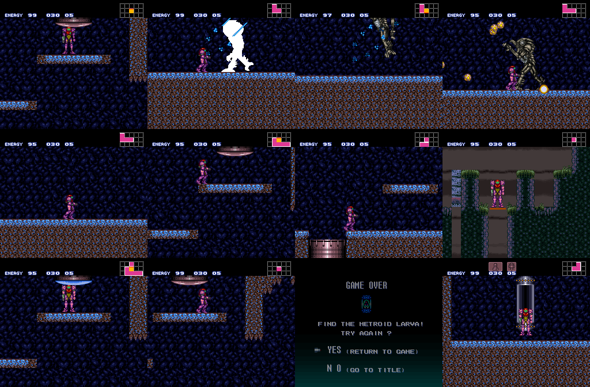

# 20h — Metroid Prime (arena da Metroid Prime Lair)

Estado: verificada (11/11/2026: validate "275 salas, 568 portas, 0 problemas" com a linha nova "impact crater (specs/20h)"; `.ips`
sha1 `958df330ea7ca818b67fc47ca89dae524c513ead` igual em dois builds (antes `e1a2125c…6707`: a ROM muda, a Lair e o chefe); grupos A,
B, C, D: A 34/34, B 64/64, C 22/22, D 26/26)
Esforço estimado: 2–3 dias (gasto: 1 sessão; a luta achada por busca gulosa no emulador, como a 19k)
Épico: [20 — Impact Crater](20-impact-crater.md) (decisão 3, aceita pelo usuário: arena na Lair no molde da Omega Pirate; linha 20h da
tabela de filhas); modelos: [19k](19k-omega-pirate.md) (a terceira cópia do Bomb Torizo, a arena do bit do Torizo, as portas cinza de
tipo 2, a busca gulosa da luta), [20e](20e-entrada-impact.md) (o evento de vitória de uma arena = o bit dela), [20g](20g-infusion-subchambers-impact.md)
(a descida; a porta de chão da Subchamber Five era parede até aqui).

## Contexto

A 20g deixou a descida pronta e a porta de chão da Subchamber Five parede. Falta a **região D**: a **Metroid Prime Lair** (P11, 4×4,
`impact_lair` em `tools/impact/rooms.py`; a tarefa chamou de `impact_metroid_prime_lair`, a chave real é `impact_lair`) com a luta final.
Pela decisão 3 do épico: **uma arena só, na Lair**, cópia de chefe do SM com vida e ataques próprios, travada por portas que abrem na
vitória. A 20i liga o fim do jogo ao evento de vitória desta filha.

## Estado atual verificado (antes)

- validate "274 salas, 566 portas, 0 problemas"; `.ips` sha1 `e1a2125c8aa995a91f227f42e14e9dae15bc6707`; grupos A 34/34, B 64/64,
  C 22/22, D 24/24 (20g).
- O Prime (20a): a Lair tem na camada 0 o `MetroidPrimeStage2`, 1 `MetroidBeta`, 2 `MetroidAlpha` (os que nascem na luta) e a
  `Phazon Pool`; nenhuma porta (a Lair é o fundo da queda). Vida e ataques do Metroid Prime **não lidos** (incerto); o único dado de
  dano medido é um `DamageableTrigger` da primeira fase com o Power Beam como fraqueza. Nenhum dump de chefe existe em `research/`.
- O Bomb Torizo já é o Thardus (18k) e o Omega Pirate (19k): código corrigido no lugar (a área lida como 0, a posição fixa
  `TORIZO_SPOT` = (776, 368), o chão na linha 26), as tabelas de paleta escolhidas por área (o Omega na área 5, o Thardus nas outras).
- Bits de chefe da área 0 na ROM vanilla: só `$04` (a porta e o estado da sala do Bomb Torizo, `$8F:9804`, órfã); nenhum código lê
  o byte da área 0 fora dos dados de sala (`vendor/sm/src`).

## Premissas (declaradas antes de agir)

1. **O chefe é o Bomb Torizo de novo** (a terceira cópia, `METROID_PRIME` em `$A0:FA3F`): é o molde da 19k pronto (arena do bit do
   Torizo, porta cinza de tipo 2, posição fixa no chão da linha 26), e o espaço do `$A0` estava previsto na 20a para isso.
2. **Uma fase só** (decisão 3 do épico, já aceita: a alternativa "várias fases como no Prime" foi recusada por custo). A essência, a
   Phazon Pool e os Metroids que nascem na luta ficam fora (o Torizo ocupa toda a VRAM de inimigos da sala).
3. **Vida 3000** (escolha nossa: o Prime não foi lido; acima dos 1200 do Omega, o último chefe do jogo). **Ataques e vulnerabilidade
   = os do Torizo** (golpe, orbes, onda sônica; toque 8; todo feixe 1×, míssil 1×, super 2×, tiro carregado 1×): o feixe fere, como o
   exoesqueleto do Prime. Contas: 30 mísseis (de 235 na rodada 6), 150 tiros do Power Beam puro, 10 tiros do Plasma + Ice + Wave (300).
4. **Evento de vitória** = o de toda arena (19k, 20e): a morte do Torizo liga o bit `$04` da área 0 (o código dele), a rotina das
   arenas liga o **bit `$10` da área 0** = "chefe final vencido" (a 20i lê esse bit). Nenhum prêmio.
5. **A porta**: a Lair tem uma só, a do teto para a Subchamber Five. Ela tranca até a vitória com a tampa cinza do Torizo (tipo 2,
   abre no bit `$04`); depois da vitória não há PLM (o Prime não tem porta ali), mas o nível é o mesmo nos dois estados e guarda a
   tampa azul (qualquer tiro abre). "Portas de plasma nas entradas" da tarefa: o Prime não tem porta nem trava nessa doca, e o
   validador só aceita tampa de cor onde o Prime tem (`GATES`), então nenhuma de plasma aqui.
6. **Cores**: as do Thardus (o seletor de paleta só troca na área 5). Não há textura do Metroid Prime despejada; fica como pergunta.

## Mudança feita

1. **A cópia** `METROID_PRIME` (`tools/chozo/bosses.py`): o Bomb Torizo em `$A0:FA3F` (a casa da grade depois do Omega), vida 3000,
   o resto do Torizo. **A arena** (`ARENAS`): `impact_lair`, bit `$10`, condição `BOSS_BIT` com o `$04` do Torizo, `needs = {Missile}`,
   sem prêmio, música do Torizo (`$24`, faixa 3).
2. **A espécie e o lugar**: `metroid_prime` (`tools/frigate/enemies.py`, os valores do Omega, `fixed=(776, 368)`);
   `tools/impact/enemies.py`: `Spawn(MP, 48, 26)` na Lair, `ARENA_ROOMS`, `ARENA_KINDS` (`MetroidPrimeStage2`) e `PRIME_LAIR_LAYER0`
   (o que o Prime tem e fica fora).
3. **A sala** (`tools/impact/layouts.py` `lair`): o salão nas duas telas de cima (linhas 2–25), o chão na linha 26 de parede a parede
   (a posição do Torizo fixa a linha), a plataforma da porta do teto (linha 6) e, a oeste dela, o zigue-zague (21, 16, 11) da
   Subchamber Four espelhado; o chão a leste livre até o teto para a luta; a metade de baixo de rocha; duas colunas de phazon.
4. **A porta** (`tools/impact/rooms.py`): `ACTIVE_REGIONS` com a D; `BOSS_DOORS = {(impact_lair, impact_subchamber_five)}`;
   `build_rooms` marca a porta de chefe como a da Mines (tampa `boss`, trava `BOSS_GATE`, sem tampa morta). O build (sem mudança) põe
   a cinza de tipo 2 no estado vivo e nenhuma no morto.
5. **O validador** (`tools/validate.py`):
   - `impact_opens` / `impact_arrival`: a rodada do teleporte (6) e o equipamento dela para as salas da cratera (fora do passeio das
     rodadas); `check_bosses`, `check_arenas` e `arena_gear_fight` contam a Lair com eles; a linha das arenas diz "150 tiros do Power
     Beam ou 30 mísseis…" (antes, toda arena com `needs` dizia "imune ao Power Beam").
   - `check_gates` passa também pelas salas da cratera (antes só `world_rooms`): as tampas da Lair nos dois estados na ROM.
   - `check_impact_enemies`: chefe só na arena (`ARENA_ROOMS`), só do `ARENA_KINDS`.
   - **`check_impact_boss`** (novo, linha "impact crater (specs/20h)"): uma arena só na área 0, a da Lair, do Torizo, bit `$10`, com
     `needs`, sem prêmio; os bits vanilla da área 0 = `{$04}`; um só inimigo, o do `MetroidPrimeStage2`; toda porta da Lair em
     `BOSS_DOORS` com a cinza do Torizo; sem o `needs` a porta não abre, com ele abre; nenhum outro estado da área 0 escolhido por
     bit de chefe.
6. **Testes** (grupo D, `tests/run_tests.py`):
   - **`impact_metroid_prime`**: a arena viva (vida 3000 em (776, 368), bits `$04`/`$10` da área 0 desligados, música `$24`, tampa
     `C854` no slot 39); a luta **de verdade** (`PRIME_FIGHT`, 23 movimentos, feixe Plasma + Ice + Wave, nada por RAM) até a vida 0;
     a morte (400 quadros), os bits `$14` da área 0, a música parada, energia 95; sobe o zigue-zague, um tiro abre a tampa, sobe pela
     porta: a Subchamber Five, de pé no chão; atalho até a Entry Point, plataforma, sobe: o Artifact Temple com o bit `$10`; a Lair de
     novo: o estado morto (nenhum inimigo, a música da área, nenhuma tampa PLM).
   - **`impact_prime_porta_e_morte`**: salva na Entry Point (marcador 9 horas); na Lair viva três tiros na tampa e o pulo: a tampa
     fica, ela fica na Lair; energia 2 por RAM (só para encurtar; o golpe é de verdade): anda até o Metroid Prime, game over;
     continue: a última save station (a Entry Point, área 0, o marcador), os bits da área 0 desligados; a Lair de novo viva, 3000.

Fotos do emulador (`build/tests/20h_*`), da esquerda, de cima: a chegada na plataforma (a tampa cinza no teto); o tiro que acerta (o
Torizo branco no piscar); a luta; morrendo; a vitória; de volta na plataforma; a Subchamber Five; o templo; a Lair morta (a tampa azul
do nível); a porta fechada antes da vitória; o game over; o continue na Save Station da Entry Point.

## Critérios de aceite

1. validate "0 problemas" com a linha da 20h. (protege = arena, chefe único, bit, porta trancada até a vitória, a porta e as tampas
   na ROM, o equipamento da rodada; falha_quando = as mutações; não_prova = que a luta agrada)
2. `impact_metroid_prime` (protege = a luta vencida com dano real, o evento, a porta aberta, a subida e a volta ao templo, o estado
   morto) e `impact_prime_porta_e_morte` (protege = a porta fechada antes da vitória, a morte, o continue na save station, a arena viva
   de novo).
3. Dois builds com o mesmo sha1 (a ROM muda).
4. Todos os grupos na ordem A → B → C → D.
5. Mutações pegas.

## Mutações (`scratchpad/s20h/mutate.py` → `mutate.out`, em memória e numa cópia da ROM; nada no código real)

| Mutação | Resultado |
|---|---|
| M0 controle | limpa |
| M1 porta da Lair sem a trava de chefe (abre antes da vitória) | pega ("não é a cinza do Torizo…", "a porta da Lair abre sem ['missile']") |
| M2 arena sem `needs` | pega |
| M3 bit da arena `$04` (o vanilla da área 0) | pega ("bit de chefe $04 (os nossos: um de $08-$80…)") |
| M4 arena esperando a cota de mortes, não o bit do Torizo | pega |
| M5 um Metroid junto do Metroid Prime | pega ("o Torizo não é o único inimigo da sala") |
| M6 o Metroid Prime numa Subchamber | pega ("fora da arena (ARENA_ROOMS)") |
| M7 `BOSS_DOORS` vazio | pega |
| M8 controle depois | limpa |
| R1 ROM: a tampa do estado vivo de tipo 4 (nunca abre) | pega (só depois de `check_gates` passar pelas salas da cratera: antes **não** pegava) |
| R2 ROM: o estado morto escolhido pelo bit `$08` | pega |
| R3 ROM: vida 30000 | pega ("não se vence com o equipamento da rodada 6: 300 mísseis") |
| R4 ROM: **vida zero sem o evento** (a entrada da Lair na tabela das arenas com bit 0) | pega |
| R5 controle depois | limpa |

As mutações de ROM não foram rodadas no emulador, só no validador.

## Riscos e reversão

- **A luta é fácil com o feixe**: 10 tiros do Plasma + Ice + Wave (a busca venceu em 23 movimentos, perdendo 4 de energia). A vida
  3000 é escolha; mais vida é trocar um número (e refazer a busca do teste).
- **O teste da luta depende do estado exato** da entrada (como o da 19k): mudar a sala, a rota até ela ou o Torizo pede refazer a busca
  (`scratchpad/s20h/greedy.py`).
- **A tampa azul depois da vitória**: o nível é um só para os dois estados; o Prime não tem porta ali.
- **A subida pela porta do teto** usa o Space Jump (rodada 6), como a 20g.
- Reversão: tirar `METROID_PRIME` de `COPIES`, a arena de `ARENAS`, `metroid_prime`, o spawn e os dicionários da Lair em
  `impact/enemies.py`, `lair` de `LAYOUTS`, a região D de `ACTIVE_REGIONS`, `BOSS_DOORS`, `check_impact_boss`, `impact_opens`/
  `impact_arrival` e os 2 testes. A ROM volta à da 20g.

## Fora de escopo

- O fim do jogo (20i: lê o bit `$10` da área 0). A segunda fase (a essência), a Phazon Pool, os Metroids da luta, a luta nas
  Subchambers (decisão 3). Música própria. As cores do Metroid Prime (pergunta abaixo).

## Desvios

- **Teste `nivel_cruza_banco_*`**: `plm_cells` deixa o tubo da save station (achado ao rodar o B; ver "Verificação").
- **A chave da sala** é `impact_lair` (a tarefa disse `impact_metroid_prime_lair`).
- **Sem porta de plasma**: o Prime não tem porta nem trava na doca da Lair; a porta tranca com a cinza do Torizo e, depois, fica a
  tampa azul do nível (não aberta como no Prime).
- **`check_gates` agora passa pelas salas da cratera** (achado da mutação R1: as tampas da cratera na ROM não eram conferidas).
- **A morte no teste** tem a energia baixada por RAM antes do golpe (só para encurtar; o golpe e o game over são de verdade); a
  vitória não usa RAM nenhuma.
- **Cores do Thardus** no Metroid Prime.

## Perguntas ao usuário

1. **Vida 3000 e o feixe ferindo** (10 tiros do Plasma combinado vencem). Quer mais vida, ou imune ao feixe sem carga como o Omega?
2. **Uma fase** (a decisão 3). Quer as duas fases do Prime (exoesqueleto e essência) numa filha a mais?
3. **As cores**: hoje o Metroid Prime sai com as do Thardus (cinza de pedra). Quer as do Prime (despejar as texturas e um seletor da
   área 0, como o do Omega)?

## Verificação (11/11/2026, pasta real)

- `python3 -I tools/build.py` duas vezes → `sha1sum build/metroid_prime_snes.ips`: `958df330ea7ca818b67fc47ca89dae524c513ead` nas duas.
- `python3 -I tools/validate.py` → "275 salas, 568 portas, 0 problemas". Linhas novas ou mudadas:
  - nova: "impact crater (specs/20h): Metroid Prime na impact_lair (Prime: MetroidPrimeStage2 (Metroid Prime); decisão 3: uma arena,
    a luta em duas fases do Prime fora): cópia $A0:FA3F do Bomb Torizo $EEFF, vida 3000, toque 8, os ataques do Torizo; vence quando o
    Torizo liga o bit $04, a arena liga o bit $10 da área 0 (o chefe final vencido; …); a porta para impact_subchamber_five tranca até a
    vitória …; rodada 6; fora: MetroidAlpha 2, MetroidBeta 1 e a Phazon Pool".
  - arenas: "impact_lair (…): 1 metroid_prime + 0 outros, bit de chefe $04, bit $10, 150 tiros do Power Beam ou 30 mísseis
    (capacidade na rodada 6: 235) ou 50 tiros carregados … (rodada 6), até 10 por golpe, nenhum prêmio".
  - 20e: "regiões ativas: ABCD): 12 salas construídas (…, impact_lair), ligações entre elas: 11"; 20c: "12 construídas"; 20b: "$8F livre
    2145 …; $A1 livre 8691 …; 0 de 12 salas por construir"; 20f: "3 inimigos em 2 salas (metroid 2, metroid_prime 1)".
- Grupos, na ordem, cada um com `timeout 600`: **A 34/34** (203 s), **B 64/64** (234 s), **C 22/22** (269 s), **D 26/26** (221 s). A
  primeira rodada deu B 63/64: `nivel_cruza_banco_phendrana_save_station_c` (o alocador de nível andou com a Lair e, pela primeira vez,
  uma sala de save cruza banco); os blocos diferentes eram só o tubo da save station desenhado pelo PLM dela (colunas 8–9, linhas
  8–13), que o teste não deixava; `plm_cells` passou a deixar as 2×6 casas da save station. A ROM não mudou; A–D rodados de novo.
- Emulador: `impact_metroid_prime` (a luta vencida de verdade: vida 3000 → 0 em 10 tiros do Plasma + Ice + Wave, bits `$14` da área 0,
  energia 95) e `impact_prime_porta_e_morte`, os dois no grupo D.
