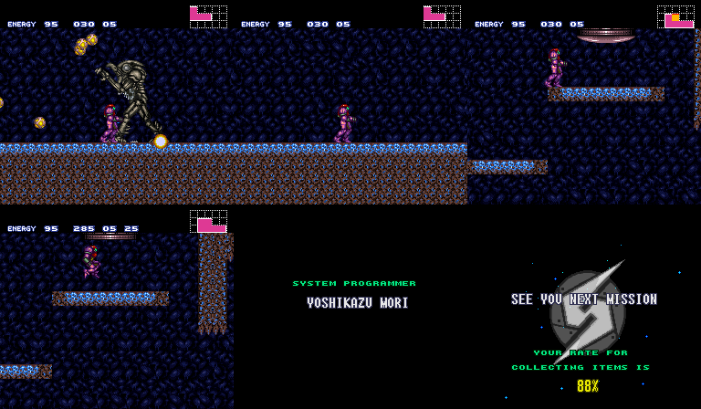

# 20i — Fim do jogo (a saída da Lair, os créditos e a tela da porcentagem)

Estado: verificada (11/11/2026: validate "275 salas, 568 portas, 0 problemas" com a linha nova "fim do jogo (specs/20i)"; `.ips`
sha1 `2f13e7563c7202f82602ad21ba00ba6588c21423` igual em dois builds (antes `958df330…3ead`: a ROM muda, o código da saída na Lair);
grupos A, B, C, D: A 34/34, B 64/64, C 22/22, D 28/28)
Esforço estimado: 1,5–2 dias (gasto: 1 sessão)
Épico: [20 — Impact Crater](20-impact-crater.md) (decisão 5, aceita pelo usuário: créditos e tela de fim com a porcentagem,
reaproveitando o fim da fragata; linha 20i da tabela de filhas); modelos: [20h](20h-metroid-prime-impact.md) (a arena, o bit `$10` da
área 0, a porta do teto), [05](05-final-da-fragata.md) (o fim do SM que a fragata usava), [19m](19m-rodadas-e-cadeia-cinco-areas.md)
(a conta da porcentagem e a checagem dos dígitos na tela).

## Contexto

A 20h deixou o Metroid Prime vencido de verdade na Lair: a vitória liga o bit `$10` da área 0 ("chefe final vencido") e abre a
porta do teto, que levava de volta à Subchamber Five e ao templo. O jogo não tinha fim próprio: o único fim com créditos era o do
Super Metroid, que a fragata usava antes da spec 05 e que hoje só toca se a nave da Landing Site decolar com o evento `$0E` (que
nenhuma jogada liga; a cadeia da 19m liga por RAM para ver a tela de 88%). Esta filha liga o fim do jogo à vitória.

## Estado atual verificado (antes)

- validate "275 salas, 568 portas, 0 problemas"; `.ips` sha1 `958df330ea7ca818b67fc47ca89dae524c513ead`; grupos A 34/34, B 64/64,
  C 22/22, D 26/26 (20h).
- O fim do SM na ROM, igual ao vanilla (conferido byte a byte com `base/sm_fix.sfc`): o estado `$26` (`GameState_38`, `$82:84BD`:
  roda o jogo enquanto a tela escurece, depois `$27`), o `$27` (`$8B:D443`: Zebes explodindo, os créditos, "SEE YOU NEXT MISSION" e
  "YOUR RATE FOR COLLECTING ITEMS IS N%"), a conta `CalcItemPercentageCount` (`$8B:E627`) e as tabelas dela (`$8B:E70D–E768`). A
  rotina da nave (`$A2:F502`, spec 05) devolve `$26` fora da área 3.
- A Lair (20h): uma porta só, a do teto para a Subchamber Five, tampa cinza do Torizo em (22, 2) até a vitória; o estado vivo roda
  a rotina das arenas como main ASM, o morto nenhum.
- Uma transição de porta não pode virar outro estado de jogo: o último passo dela grava `$0998 = 8` (`$82:E737`); o código de porta
  e o de entrada da sala rodam no meio dela (`$82:EB6C`).
- Medido no emulador (`scratchpad/s20i`, luta real até a plataforma, savestate): com a tampa fechada o topo da Samus para em
  y = 48 (a borda de baixo da linha 2 da tampa: Y 60 girando, raio 12; Y 67 de pé, raio 19), e só com o centro em X 348–420 (a
  caixa dela, raio X 5, sobre as colunas 22–25 da porta); com a tampa aberta o topo passa de 48 e chega aos blocos da porta 8
  quadros depois (Y 24, estado `$09`).

## Premissas (declaradas antes de agir)

1. **"Reaproveitar o fim da fragata" = o fim do SM como está** (estado `$26` → `$27`): era o fim da fragata antes da spec 05 e é o
   único fim com créditos e a tela da porcentagem na ROM. O texto ("SEE YOU NEXT MISSION", "YOUR RATE FOR COLLECTING ITEMS IS"), os
   créditos do SM e a cena de Zebes explodindo ficam iguais (trocar é arte e texto novos: fora, como na spec 05, opção B).
2. **A saída é a porta do teto da Lair**, a única: depois da vitória, a tampa aberta e o pulo para dentro dela levam ao fim, sem
   passar pela Subchamber Five nem voltar ao templo (no Prime a Lair é o fim do mundo).
3. **O gatilho é posição + bit**, não a transição: um código na Lair (main ASM dos dois estados) vê o topo da Samus acima da borda da
   tampa, dentro das colunas da porta, com o bit `$10` da área 0 ligado; trava a Samus (código 0 da Samus, `$90:F084`) e liga o
   estado `$26` com o escurecer imediato (`$0723`/`$0725` = 0, como a nave `$A2:AD0E`). A medição acima mostra que o ponto só se
   alcança com a tampa aberta e sempre antes da porta.
4. **A porcentagem é a da conta do jogo** (`$8B:E627` com as tabelas da ROM construída), igual à da 19m: com os 88 itens, 88%. No
   emulador, a luta usa o equipamento da rodada 6 por RAM (o da 20h: 16% na tela); para ver o número da cadeia completa, o
   equipamento de todos os itens (a soma do validador, `items_gear`) é posto por RAM **depois da vitória** e antes da saída. A
   vitória é a luta real; a cadeia completa até o fim é da 20j.

## Mudança

1. **`tools/impact/ending.py`** (novo): `exit_routine(area, bit, cap_x, cap_y)` (77 bytes no `$8F`: em jogo (`$0998 = 8`), com o bit,
   `X + raio > 16·cap_x`, `X − raio < 16·(cap_x + 4)`, `Y − raio Y < 16·(cap_y + 1)`: `JSL $90:F084` com A = 0, `$0998 = $26`,
   `STZ $0723/$0725`) e `alive_main_asm` (o `JSL` da rotina das arenas e um `JMP` para a saída).
2. **`tools/build.py`**: `lair_exit_cap` (a tampa da única porta de teto da Lair, `door_cap_and_screen`); no ramo das arenas, a Lair
   ganha a saída no estado morto e a rotina + saída no vivo (`$8F:F84D` / `$8F:F800` neste build).
3. **`tools/validate.py`**:
   - `items_gear` (a soma do equipamento dos itens, tirada de `check_world_rounds`, que passa a usá-la; a linha das rodadas igual).
   - `check_arenas_in_rom`: a Lair espera o main ASM vivo = rotina + saída e o morto = a saída (antes: o stub e nenhum).
   - **`check_impact_ending`** (linha nova "fim do jogo (specs/20i)"): a arena da Lair com o bit `$10`; a Lair com uma porta, a do teto,
     de chefe; o código da saída nos dois estados = o gerado para a tampa dessa porta, e nos próprios bytes a leitura do bit
     (`LDA $7ED828 / AND #$0010`) e o estado (`LDA #$0026 / STA $0998`); o fim do SM igual ao vanilla (`ENDING_CODE`: a tabela de
     estados em `$26`/`$27`, `$82:84BD`, `$8B:D443`, `$8B:E627` e as tabelas); a porcentagem dos itens colocados com as tabelas da ROM
     construída = um por item.
4. **Testes** (grupo D, `tests/run_tests.py`):
   - `prime_won` (a parte da 20h até a plataforma, com o nome das fotos); `impact_metroid_prime` termina na plataforma (a volta à
     Subchamber Five, ao templo e o estado morto visto depois saíram: nenhuma jogada chega lá agora; o validador lê o estado morto).
   - **`impact_fim_do_jogo`**: a luta real (`PRIME_FIGHT`), a plataforma; o equipamento da cadeia por RAM (energia 1499, mísseis 285,
     super 5, power bombs 25, os itens e feixes); o tiro abre a tampa, o pulo: ainda na Lair, estado `$26`, a Samus parada (Y 57);
     30 quadros: `$27`, ainda na Lair (nenhuma transição); 7000 quadros: os créditos (foto); 14000: a função do cinema
     `$8B:E7BA` (`nullsub_127`, o fim dos créditos) e os dígitos que a conta do jogo escreveu = os da porcentagem **calculada**
     (`item_percentage` com as tabelas da ROM, que tem de dar 1 por item e o `CHAIN_END_PERCENT` da 19m, senão o roteiro nem é
     gerado); 2000 quadros depois, igual (a tela fica).
   - **`impact_fim_sem_vitoria`**: a arena viva (bits `$04`/`$10` da área 0 desligados); a Samus posta por RAM no ponto da saída
     (X 380, Y 62: o topo acima da borda da tampa, nas colunas da porta): 120 quadros depois, estado 8, na Lair. (O mesmo ponto
     depois da vitória liga o `$26` no quadro seguinte: medido, `scratchpad/s20i`.)

Fotos do emulador (`build/tests/20h_fim_*`, `build/tests/20i_*`), da esquerda, de cima: o Metroid Prime morrendo; a vitória; na
plataforma, debaixo da tampa; a saída (a Samus parada no pulo, a tampa aberta, o HUD com o equipamento da cadeia); os créditos; a
tela de fim com 88%.

## Critérios de aceite

1. validate "0 problemas" com a linha "fim do jogo (specs/20i)". (protege = o bit lido, a saída na porta da Lair, o estado `$26`, o
   fim do SM intacto, a porcentagem um por item; falha_quando = as mutações M1–M9; não_prova = que o fim agrada)
2. `impact_fim_do_jogo` (protege = a saída depois da vitória real, o fim sem transição, os créditos até a última função, a
   porcentagem calculada na tela) e `impact_fim_sem_vitoria` (protege = sem a vitória o ponto da saída não faz nada).
3. Dois builds com o mesmo sha1 (a ROM muda).
4. Todos os grupos na ordem A → B → C → D.
5. Mutações pegas.

## Mutações (`scratchpad/s20i/mutate.py` → `mutate.out`, `emu_mut.py` → `emu_mut.out`; cópias da ROM em memória ou no scratchpad e
dados em memória; nada no código real)

| Mutação | Resultado |
|---|---|
| M0 controle | limpa |
| M1 ROM: a saída sem ler o bit (o `BEQ` virou `BRA +0`: o fim sem a vitória) | pega |
| M2 ROM: a saída lendo o bit `$08` | pega |
| M3 ROM: a saída liga o estado `$08` (sem fim) | pega |
| M4 ROM: o estado morto sem a saída | pega |
| M5 ROM: porcentagem errada (o divisor dos mísseis 5 → 10) | pega ("difere do SM") |
| M6 ROM: porcentagem errada (o Grapple fora da tabela de itens) | pega |
| M7 ROM: a tabela de estados com o `$27` em outro lugar | pega |
| M8 memória: a arena da Lair com o bit `$20` (o fim lê `$10`) | pega |
| M9 memória: a saída esperada uma coluna ao lado (a ROM fora da porta) | pega |
| M10 controle depois | limpa |
| E1 emulador, ROM cópia de M1: `impact_fim_sem_vitoria` | falha (`$0998 = 0027`, esperado `0008`) |
| E2 emulador: `impact_fim_do_jogo` esperando 87% | falha (`7E33A0 = 3868`, esperado `3867`) |
| E3 emulador: controle (o roteiro real até os dígitos) | passa |

## Riscos e reversão

- **O ponto da saída depende da tampa**: medido para a tampa em (22, 2) de 4 blocos; o código é gerado da posição da porta
  (`lair_exit_cap`), e o validador confere que o da ROM é o dessa porta. Mudar a porta da Lair muda o código junto.
- **Chegar à Lair pela porta do teto com o bit ligado** daria o fim na hora (a Samus chega com o topo acima da borda): nenhuma jogada
  faz isso (o bit só liga dentro da Lair e a única saída é o fim; não há save station depois da vitória).
- **O fim do SM**: Zebes explodindo e os créditos do Super Metroid (a decisão 5: reaproveitar). O tempo de jogo decide a imagem da
  Samus no fim, como no SM.
- **O roteiro do teste depende da luta da 20h** (`PRIME_FIGHT` e o estado exato da entrada).
- Reversão: tirar `tools/impact/ending.py`, `lair_exit_cap` e o ramo da Lair em `tools/build.py`, `check_impact_ending`,
  `ENDING_CODE`/`LAIR_EXIT_*`, a exceção da Lair em `check_arenas_in_rom`, e os testes `impact_fim_*`; voltar `impact_metroid_prime`
  ao da 20h. A ROM volta à da 20h.

## Fora de escopo

- A cadeia completa até o fim (20j: a cadeia de hoje termina na nave com o evento `$0E` por RAM, `fc_ending`, que continua igual).
- Texto, créditos ou cena próprios do Prime (a alternativa da decisão 5). A nave da Landing Site com o evento `$0E` (fica como está).
- As pendências herdadas (abaixo).

## Desvios

- **`impact_metroid_prime` mudou**: termina na plataforma; a volta à Subchamber Five e ao templo depois da vitória e o estado morto
  da Lair visto numa visita saíram (agora a porta é o fim). O estado morto continua conferido na ROM pelo validador.
- **O fim não usa a transição de porta** (ela sempre termina no estado 8): a Samus para debaixo da porta, no pulo, e a tela escurece.
- **O equipamento da cadeia por RAM** no teste do fim (só depois da vitória), para a tela mostrar o número da cadeia; a luta é real.
- O "texto do jogo" na tela de fim é o do SM (premissa 1).

## Pendências herdadas (mantidas como estão)

- (20g) O ácido das Subchambers em 3 de 6 salas, laranja-ferrugem: decisão aberta.
- (20g) A tela vazia dos testes de mapa é (30, 30).
- (20h) Sem resposta: a vida 3000 e o feixe ferindo (ou imune ao feixe sem carga, como o Omega), as duas fases do Prime, as cores do
  Prime (hoje as do Thardus).

## Perguntas ao usuário

1. O fim é o do Super Metroid (Zebes explodindo, os créditos do SM, "SEE YOU NEXT MISSION"). Quer textos do Prime na tela de fim ou
   nos créditos (uma filha a mais, arte e texto)?
2. A saída é a porta do teto da Lair (no Prime a Lair não tem porta: o fim vem com a morte do Prime). Quer o fim logo depois da
   morte, sem precisar subir até a porta?

## Verificação (11/11/2026, pasta real)

- `python3 -I tools/build.py` duas vezes → `sha1sum build/metroid_prime_snes.ips`: `2f13e7563c7202f82602ad21ba00ba6588c21423` nas duas.
- `python3 -I tools/validate.py` → "275 salas, 568 portas, 0 problemas". Linha nova:
  "fim do jogo (specs/20i): a saída da impact_lair = a porta do teto para impact_subchamber_five (tampa em (22, 2), aberta só depois
  da vitória): com o bit $10 da área 0 (o chefe final vencido) a Samus para antes da porta e o jogo vai ao estado $26 -> $27 (o fim
  do SM, como a fragata usava: créditos e a tela 'YOUR RATE FOR COLLECTING ITEMS', 5 trechos iguais ao SM), sem o bit nada; código
  nos dois estados da Lair ($F84D / $F800); a porcentagem na tela com os 88 itens (tabelas da ROM construída): 88% (energia 1499,
  mísseis 285, super mísseis 5, power bombs 25)". Mudou só a folga do 20b ($8F livre 2145 → 2061: os 84 bytes da saída).
- Grupos, na ordem, cada um com `timeout 600`: **A 34/34** (198 s), **B 64/64** (202 s), **C 22/22** (274 s), **D 28/28** (254 s;
  26 da 20h + `impact_fim_do_jogo` + `impact_fim_sem_vitoria`).
- Emulador: `impact_fim_do_jogo` — a luta real, a saída (estado `$26`, Y 57, na Lair), `$27`, os créditos, a tela de fim com
  **88%** (dígitos `7E33A0`/`7E33E0` escritos pela conta do jogo; a conta da 19m/validador: 88 itens = 88%); a última função do
  cinema `$8B:E7BA` aos 14000 e aos 16000 quadros. Foto `build/tests/20i_porcentagem.png`.
