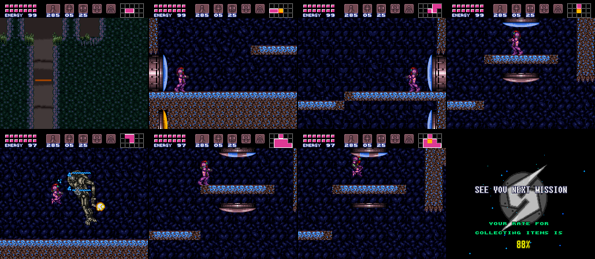

# 20j — Rodadas e a cadeia completa com a Impact Crater (fecha o épico 20)

Estado: **verificada** (11/11/2026: validate "275 salas, 568 portas, 0 problemas", todas as linhas de antes iguais e uma nova, a do
épico; `.ips` sha1 `2f13e7563c7202f82602ad21ba00ba6588c21423` igual em dois builds e igual ao de antes (a ROM não muda); grupos
A → B → C → D na pasta real: **A 34/34** (183 s), **B 64/64** (197 s), **C 22/22** (246 s), **D 29/29** (214 s; 28 de antes + `cadeia_completa_parte_6`); a cadeia completa em 6 partes passa do começo do jogo à tela do fim com **88%**; mutações
9/9 pegas, com os controles limpos). Rascunho → implementada → verificada (épico aprovado pelo usuário em 10/11/2026; linha 20j da
tabela de filhas). **Fecha o épico 20.**
Esforço estimado: 1–1,5 dia (linha 20j do épico). Medido: 1 sessão.
Épico: [20 — Impact Crater](20-impact-crater.md) (linha 20j; critérios de aceite); modelo: [19m](19m-rodadas-e-cadeia-cinco-areas.md)
(a cadeia em partes ligadas por estado salvo, a conta da porcentagem, `check_epic_mines`); base: [20e](20e-entrada-impact.md)–
[20i](20i-fim-do-jogo-impact.md).

## Contexto

Com a 20i as 12 salas da cratera, a luta com o Metroid Prime e o fim do jogo estão na ROM, cada um conferido no seu teste. A cadeia
completa (19m) ainda terminava fora da cratera: na parte 5, `fc_ending` punha a Samus na nave e ligava por RAM o evento `$0E` (a fuga
de Zebes) para ver a tela do fim com 88%. Faltava o que o épico deixou para a última filha: a cadeia do começo do jogo ao fim **de
verdade**, passando pela cratera, com o Metroid Prime vencido de verdade e a saída da Lair levando à tela do fim; uma checagem do
épico inteiro; e o épico fechado.

## Estado antes (verificado)

Pasta real, 11/11/2026: `.ips` sha1 `2f13e7563c7202f82602ad21ba00ba6588c21423` (o da 20i); validate "275 salas, 568 portas, 0
problemas" (`scratchpad/s20j/v_antes.txt`); grupos A 34/34, B 64/64, C 22/22, D 28/28 (20i). A cadeia em 5 partes (19m), a parte 5
terminando com `fc_end` (a nave, o save, o game over e o continue) e `fc_ending` (o evento `$0E` por RAM).

## Premissas (declaradas antes de agir)

1. **As rodadas não mudam.** A regra da 20e continua: as salas da cratera ficam **fora** do passeio das rodadas (`world_rooms`) e são
   andadas pela checagem própria (`check_impact_rooms`) com o equipamento da rodada em que o teleporte abre (a 6, a última). A 19m não
   exigia mais nada da cratera: ela **não tem item de verdade** (20a), então **nenhum item muda de rodada** e a linha das rodadas fica
   igual, byte a byte. A checagem nova do épico prova isso (a conta dos itens com e sem as salas da cratera é a mesma).
2. **A cadeia entra na cratera depois de tudo** (rodada 6 com os 88 itens), pelo teleporte do Artifact Temple, que só existe com o
   Omega Pirate morto: na cadeia ele é vencido de verdade na rodada 6 da Mines (19m), então o bit `$10` da área 5 vem da luta, não de
   RAM.
3. **O método é o da 19m**: a mesma `FullChain`, partes ligadas por estados salvos do emulador (`CHAIN_PARTS`, `chain_handoff`,
   `run_chain_parts`), os atalhos contados por `FullChain.note`, as caminhadas medidas dos testes das regiões reaproveitadas.
4. **O fim de verdade substitui o atalho**: `fc_ending` (a nave com o evento `$0E` por RAM) sai; a tela do fim vem da saída da Lair
   (20i), com o equipamento que a cadeia pegou (nada por RAM: na 20i o teste do fim punha o equipamento por RAM).

## Mudança

1. **Validador** (`tools/validate.py`): `check_epic_impact` (linha nova **"impact (specs/20, épico fechado na 20j)"**): as 12 salas
   da tabela construídas (as 4 regiões) na área 0; as ligações entre elas = as 11 do Prime (`impact_rooms.LINKS`: cada par de docas
   uma porta construída com a volta, mesmas salas, lados e telas), nenhuma porta para fora da cratera; **nenhum item numa sala da
   cratera**, e por isso os itens do jogo e a porcentagem do fim (`$8B:E627`, um por item) iguais com e sem as salas da cratera; toda
   trava do Prime (`DOCK_LOCKS`, 10 docas) numa ligação construída; o único elevador para a cratera é o teleporte do Artifact Temple
   (decisão 7), aberto na última rodada do passeio; a save station da Entry Point e a recarga de mísseis; uma arena só, a do Metroid
   Prime na Lair, com o bit `$10` (o que o fim lê, `check_impact_ending`). A linha das rodadas **não muda**.
2. **A cadeia** (`tests/run_tests.py`):
   - `chain_percent` (a conta da porcentagem que `fc_end` fazia, agora usada também no fim da cratera): `item_percentage` com as
     tabelas da ROM construída, a partir do que a cadeia pegou; tem de dar um por item, todos os itens colocados das cinco áreas
     pegos e `CHAIN_END_PERCENT` (88), senão o roteiro nem é gerado.
   - `fc_end`: depois do continue, a munição da nave (mísseis, super mísseis, power bombs no máximo: a nave recarrega tudo) conferida
     e anotada (a parte 6 começa dali).
   - **`fc_crater`** (parte 6): do transporte North da Chozo sobe o elevador; por `door_teleport` ao Artifact Temple (a plataforma está
     lá: o Omega vencido na cadeia); desce o teleporte (`chain_ride`, a Samus posta na plataforma, atalho contado; ali ela termina
     **1 px** a leste do meio, medido, nos outros elevadores 2); as regiões A, B e C **andadas** como `impact_regiao_b_rota` e
     `impact_descida_rota` (as tampas de plasma abertas a tiro): Tunnel A, Phazon Core pelo chão, o zigue-zague leste até a
     prateleira da R1, Tunnel B, Infusion Chamber pelas bordas até o buraco, a plataforma da Subchamber One, o zigue-zague até a L2, a
     Subchamber Two; por `door_teleport` (sem trava: a queda do Prime) as Subchambers Three, Four e Five e a Lair pela porta de chão
     da Five (como `prime_entry`): a arena viva; o **Metroid Prime vencido de verdade** (`CHAIN_PRIME_FIGHT`, nenhuma RAM na luta): os
     bits `$04` e `$10` da área 0, a energia 1499 → 1497 (um toque); andando para leste até onde a luta da 20h termina
     (`CHAIN_PRIME_EAST`, x 830) e pelo zigue-zague até a plataforma da porta do teto (`M20H_UP`).
   - **`fc_crater_ending`**: na plataforma, os 88 bits de item, os itens, os feixes e as capacidades que a cadeia pegou (as checagens
     do `fc_end`); o tiro abre a tampa, o pulo (`M20I_EXIT`): na Lair, estado `$26`, a Samus parada (Y 57); `$27`; os créditos; no
     fim, os dígitos que a conta do jogo escreveu = os da porcentagem **calculada** pela `chain_percent` (88); a última função do
     cinema (`$8B:E7BA`) aos 14000 e aos 16000 quadros.
   - `fc_ending`, `ENDING_EVENT` e `ENDING_RATE_FRAMES` saíram (o evento `$0E` por RAM não é mais usado).
3. **A cadeia em seis partes** (`CHAIN_PARTS`): partes 1–4 iguais às da 19m; **parte 5** = rodada 6 nas cinco áreas e o `fc_end`,
   termina no transporte North da Chozo (grupo D); **parte 6** = a cratera, o Metroid Prime e o fim (grupo D, depois da 5).
   `CHAIN_GROUP` com a sexta parte em D.

A ROM não muda (nenhum arquivo da ROM mexido).

### A luta da cadeia

A luta da 20h (`PRIME_FIGHT`, buscada da entrada do teste `impact_metroid_prime`, com o equipamento da rodada 6 por RAM e 99 de
energia) **não vence da entrada da cadeia** (medido: o Metroid Prime fica com 2100 de 3000; a Samus chega à Lair noutro x, 443 em vez
de 451, e a luta vai por outro caminho). Buscada de novo do estado da cadeia, com o mesmo método da 20h (`scratchpad/s20j/greedy.py`,
cópia do `s20h/greedy.py`: a cada passo todos os pares de lances candidatos, o melhor pela vida tirada do chefe, a energia e a
distância): **`xXXRsRsassaasaasahs`** (19 lances, 10 tiros de 300), a energia 1499 → 1497. A luta termina em x 640; a subida medida da
20h começa em x 830, então a Samus anda 70 quadros para leste antes (66–74 quadros também chegam à plataforma, medido).

## Critérios de aceite

1. validate 0 problemas; todas as linhas de antes iguais (a das rodadas e a do Tallon também); a linha nova do épico. (protege = as
   12 salas e as 11 ligações do Prime, nenhum item na cratera, a porcentagem igual, o teleporte da última rodada, o chefe e o bit que o
   fim lê; falha_quando = mutações V1–V4; não_prova = que o fim agrada)
2. As seis partes passam; o roteiro com outra porcentagem esperada ou sem uma parte da rodada 6 levanta erro ao ser gerado (T1–T2); no
   emulador, uma luta mais curta falha, a tela do fim esperando outra porcentagem falha (E1–E2).
3. Dois builds com o sha1 de antes (a ROM não muda); cada grupo numa execução, A → B → C → D.

## Plano de testes

| Camada | O quê | Qtde |
|---|---|---|
| validate.py | `check_epic_impact` (linha "impact (specs/20, épico fechado na 20j)") | 1 nova |
| run_tests.py | `cadeia_completa_parte_1..6` (eram 5) | +1 |
| scratchpad (`s20j/`) | mutações V (validador), T (gerador), E (emulador) | 9 + controles (todas pegas) |
| imagem | `specs/img/20j-cratera-e-fim.png` | 1 |

## Riscos e reversão

- **A luta medida** vale para a entrada exata da cadeia. Mudar qualquer coisa antes dela pode pedir buscar de novo (o molde:
  `scratchpad/s20j/greedy.py`, com o estado salvo da entrada, `state0.bin`).
- **Dependência entre grupos**: a parte 6 (D) carrega o estado da 5 (D), a 5 o da 4 (C). Rodar D sozinho depois de um build novo
  roda antes as partes 1–4.
- Reversão: `tools/validate.py` (`check_epic_impact`, `EPIC_IMPACT_BOSS_ROOMS`, a chamada), `tests/run_tests.py` (`chain_percent`,
  `FULL_CHAIN_ITEMS`, `FULL_CHAIN_BEAMS`, `fc_crater`, `fc_crater_ending`, `CHAIN_PRIME_*`, o `east` de `chain_ride`, a munição no `fc_end`,
  `CHAIN_PARTS`, `CHAIN_GROUP`) e voltar `fc_ending`; nenhuma mudança na ROM.

## Fora de escopo

Mudar salas, itens, inimigos ou a luta da ROM; os testes das regiões (iguais); um fim próprio do Prime (a alternativa da decisão 5);
as pendências herdadas (abaixo), que ficam como padrão.

## Resultado

- validate (pasta real): "275 salas, 568 portas, 0 problemas"; em relação à 20i (`scratchpad/s20j/v_antes.txt` → `v_final.txt`) só
  entrou uma linha, todas as outras iguais (a das rodadas, a do Tallon e as da cratera também):
  "impact (specs/20, épico fechado na 20j): as 12 salas construídas (regiões A B C D) na área 0, 11 ligações = as do Prime (lados e
  telas), nenhuma porta para fora; nenhum item na cratera: 88 itens no jogo, porcentagem do fim 88% (igual sem a cratera); 10 travas
  do Prime nas ligações construídas; elevador: o teleporte tallon_artifact_temple <-> impact_entry_point, a partir da rodada 6 (a
  última); save station entry_point, recarga de mísseis missile_station; chefe: lair (20h, bit $10 da área 0, o que o fim lê)".
- **Rodadas**: a linha "rodadas (specs/12m, 17j, 18n, 19m)" igual byte a byte (88 itens em 7 rodadas, 88%): a cratera não muda a
  rodada de nenhum item, porque não tem item.
- build: sha1 `2f13e7563c7202f82602ad21ba00ba6588c21423` nas duas vezes (o da 20i: a ROM não muda).
- testes (pasta real, A → B → C → D, cada um com `timeout 600`): **A 34/34** (183 s), **B 64/64** (197 s), **C 22/22** (246 s), **D 29/29** (214 s; 28 de antes + `cadeia_completa_parte_6`). A primeira rodada deu B 63/64:
  `tallon_cadeia_completa` falhou porque o nome novo `CHAIN_ITEMS` já existia (o da cadeia do Tallon, 12m) e o meu o sobrescrevia;
  renomeado para `FULL_CHAIN_ITEMS`/`FULL_CHAIN_BEAMS` e os quatro grupos rodados de novo do começo (os números acima).
- **A cadeia no emulador, do começo ao fim**: as 6 partes passam (parte 1 no A, 2 no B, 3 e 4 no C, 5 e 6 no D), cada uma saindo do
  estado salvo da anterior. Medido no roteiro de desenvolvimento (`scratchpad/s20j/runpart.py`): parte 5 ~156 s, parte 6 ~35 s.
- **A luta de verdade na cadeia**: `CHAIN_PRIME_FIGHT` vence (vida 0, bits `$04`/`$10` da área 0, energia 1497); a E1 mostra que um
  lance a menos deixa o chefe vivo (vida `$012C`) e a E3 que a luta da 20h não vence dali (vida `$0834`).
- **A tela do fim**: "SEE YOU NEXT MISSION / YOUR RATE FOR COLLECTING ITEMS IS **88%**"; os dígitos que a conta do jogo escreveu
  (`7E339E`/`7E33DE` = 3868/3878, `7E33A0`/`7E33E0` = 3868/3878) = os de 88, a porcentagem **calculada** pela `chain_percent` sobre o
  que a cadeia pegou (88 itens: energia 1499, mísseis 285, super mísseis 5, power bombs 25, os itens e feixes).
- **Mutações** (`scratchpad/s20j/mutate.py` → `mutate.out`, `emu_mut.py` → `emu_mut.out`; dados em memória, nada no código real;
  controles V0, V5, T0, T3, E0, E4 limpos):
  - V1 a ligação Subchamber Three → Four noutra tela no Prime → "impact (épico): ligações construídas …"; V2 um míssil do Tallon na
    Phazon Core → "itens na cratera"; V3 a arena da Lair com o bit `$20` → "a decisão 3 diz … o bit $10"; V4 o teleporte abrindo na
    rodada 5 → "aberto na rodada 5".
  - T1 porcentagem esperada 87 → `ValueError: cadeia 19m: 88 itens de 88, porcentagem do fim 88% (o épico 19: 87%)`; T2 sem a Mines
    da rodada 6 → `ValueError: cadeia 17j: itens/rodadas diferentes das declaradas`.
  - E1 a luta sem o último lance → FAIL `7E0F8C = 012C`; E2 a tela esperando 87% → FAIL `7E33A0 = 3868, esperado 3867`; E3 a luta da
    20h na cadeia → FAIL `7E0F8C = 0834`.

### Atalhos da cadeia na parte 6 (contados por `FullChain.note`)

| Atalho | Parte 6 |
|---|---|
| `door_teleport` entre salas | 12 (8 do Chozo West ao Artifact Temple, 4 da Subchamber Two à Lair) |
| energia reposta por RAM | 1 (na chegada à cratera; ela já estava cheia) |
| Samus posta na plataforma do elevador | 1 (o teleporte do templo) |
| Samus posta perto de um item | **0** (não há item) |
| arena vencida por RAM | **0** (o Metroid Prime vencido de verdade) |
| evento ou equipamento por RAM | **0** (o fim vem da saída da Lair, com os itens da cadeia) |

Os 88 itens são os pegos pela cadeia nas partes 1–5; na cratera nada é posto por RAM além da energia na chegada.

### Desvios

- **A luta da cadeia é outra** (`CHAIN_PRIME_FIGHT`, não a `PRIME_FIGHT` da 20h): a da 20h não vence da entrada da cadeia (ver "A luta
  da cadeia"). Os testes da 20h e da 20i continuam com a deles.
- **A Samus posta na plataforma do teleporte** (`chain_ride`, atalho contado, como os elevadores da Mines na 19m), terminando 1 px a
  leste do meio (medido; nos outros, 2).
- **As Subchambers Three a Five por `door_teleport`**: as caminhadas medidas da 20g vão só até a Subchamber Two (as três de baixo
  foram conferidas pelo validador e pelos testes de dano/luta, não andadas); a cadeia segue a mesma cobertura.
- **A Crater Missile Station não é visitada** (é um beco; a recarga é conferida em `impact_regiao_b_rota`).
- **A sexta parte** (a 19m tinha cinco): a parte 5 agora termina no `fc_end`; a cratera e o fim ficam numa parte própria, ligada por
  estado salvo, também no grupo D.

## Pendências herdadas (mantidas como estão, sem resposta do usuário)

- (a) (20g) O ácido das Subchambers em 3 de 6 salas, laranja-ferrugem.
- (b) (20g) A tela vazia dos testes de mapa é (30, 30).
- (c) (20h) A luta do Prime: vida 3000 chutada, o feixe fere, uma fase, as cores do Thardus.
- (d) (20i) O fim: textos do SM; o fim vem pela porta do teto (o usuário ainda não disse se prefere o fim logo na morte do Prime).

## Perguntas ao usuário

As da 20g, 20h e 20i continuam (acima); nenhuma nova.
